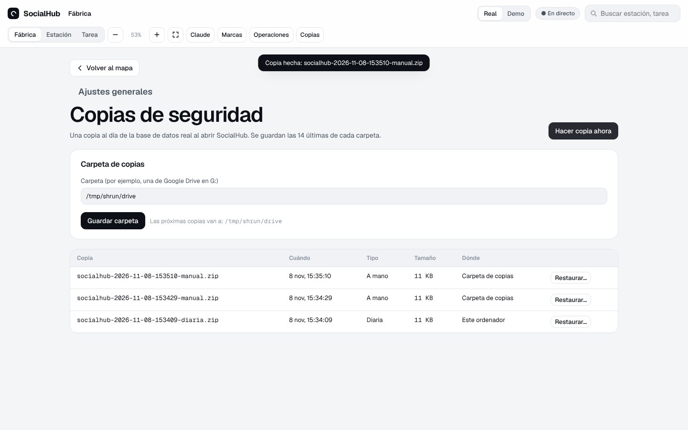

# SocialHub · Manual funcional

Cómo funciona SocialHub hoy (8 nov 2026, fases 0 a 9; falta el instalador de macOS), sin detalles técnicos. Las capturas salen del vídeo demo del 3 nov 2026 y usan los datos de ejemplo del modo Demo.

**Índice**

1. [Qué es SocialHub](#1-qué-es-socialhub)
2. [Ideas básicas](#2-ideas-básicas)
3. [El mapa de la fábrica](#3-el-mapa-de-la-fábrica)
4. [Centro de control de una promoción](#4-centro-de-control-de-una-promoción)
5. [Ciclo de vida de una publicación](#5-ciclo-de-vida-de-una-publicación)
6. [Cómo se publica](#6-cómo-se-publica)
7. [Encargos a Claude y tareas programadas](#7-encargos-a-claude-y-tareas-programadas)
8. [Marcas](#8-marcas)
9. [Operaciones externas](#9-operaciones-externas)
10. [Copias de seguridad](#10-copias-de-seguridad)
11. [Qué hace SocialHub solo y qué te toca a ti](#11-qué-hace-socialhub-solo-y-qué-te-toca-a-ti)
12. [Reglas que siempre se cumplen](#12-reglas-que-siempre-se-cumplen)
13. [Lo que aún no está](#13-lo-que-aún-no-está)

---

## 1. Qué es SocialHub

SocialHub es la fábrica de contenido de **El DeLito** (el poemario) y **Litoques** (el disco). Se instala en tu ordenador y se abre en el navegador, en `localhost:8686`. Desde ahí:

- **Planifica** la semana con propuestas de Claude que tú apruebas o rechazas.
- **Produce** las piezas (carruseles, historias, reels) con herramientas locales y los textos con Claude.
- **Revisa** cada publicación con un control de calidad antes de que la apruebes.
- **Programa** en Publer o en Publora, con 6 horas de margen como mínimo.
- **Comprueba** lo publicado y lee sus métricas a los 7 días.
- **Aprende**: los rechazos, tus correcciones y los balances vuelven a Claude en cada encargo.

SocialHub **no llama a la API de Claude**. Deja los encargos en una carpeta de Google Drive y los recogen tus tareas programadas de Claude ([sección 7](#7-encargos-a-claude-y-tareas-programadas)).

### Instalar y cerrar

- **Instalar:** abre `SocialHub-<versión>.msi`.
  - Windows avisa con «Windows protegió tu PC» porque el instalador no está firmado: pulsa «Más información» y luego «Ejecutar de todas formas».
  - Pide permiso de administrador y crea un acceso directo en el escritorio y en el menú Inicio.
- **Abrir:** con el acceso directo. SocialHub arranca y se abre en el navegador (`http://localhost:8686`). Si ya estaba abierto, solo se abre el navegador.
- **Cerrar:** botón **Cerrar** en la barra de arriba, y confirma. Se paran el motor, la base de datos y el servidor. Lo que quedó a medias sigue al volver a abrirlo.
- **Actualizar:** instala el `.msi` de la versión nueva encima. Tus datos están en `%LOCALAPPDATA%\SocialHub` y no se tocan al instalar, actualizar ni desinstalar.

## 2. Ideas básicas

| Concepto | Qué es |
|---|---|
| **Marca** | El DeLito o Litoques: su identidad, su memoria editorial, sus carpetas de Drive y sus cuentas |
| **Promoción** | Una campaña de una marca con fechas, objetivos, hitos, cadencia y reglas (p. ej. «Lanzamiento del poemario») |
| **Publicación** | Una pieza para Instagram o TikTok en un día y hora, con su texto, hashtags y archivos |
| **Estación** | Cada una de las 8 etapas de la fábrica; tiene su cola de tareas |
| **Tarea** | Un trabajo concreto en una estación, con su historial, sus intentos y sus órdenes |
| **Encargo** | Una tarea que hace Claude. Va en un archivo a Drive y su resultado vuelve por el mismo camino |
| **Modo Real / Demo** | Dos bases de datos separadas: lo que pruebas en Demo nunca toca lo real |

## 3. El mapa de la fábrica

La pantalla principal es el **anillo de 8 estaciones**:

| # | Estación | Qué hace |
|---|---|---|
| 01 | Investigación | Perfiles, contactos y oportunidades |
| 02 | Selección y estrategia | Propuestas de la semana y el plan de piezas |
| 03 | Generación de contenido | Imágenes, vídeos, textos y hashtags; primero herramientas locales |
| 04 | Revisión y calidad | Comprobaciones automáticas, revisión de Claude y tu aprobación |
| 05 | Programación | Publer, Publora o, si no da tiempo, a mano con un LEEME |
| 06 | Publicación | Confirma lo publicado con su enlace |
| 07 | Análisis de resultados | Métricas a los 7 días, sin inventar cifras |
| 08 | Retroalimentación | Balances y propuestas que vuelven a la investigación |

Cada estación muestra su estado y sus contadores: en curso, en espera, bloqueadas y con error. Los puntos del anillo son tareas que pasan de una estación a la siguiente.

En la barra de arriba están:
- El cambio entre **Real** y **Demo**.
- El buscador de estaciones y tareas.
- El zoom. Con la rueda del ratón te acercas a cualquier zona. El mapa no te deja arrastrarlo ni alejarlo hasta quedarte sin nada a la vista: el contenido siempre se ve (como mínimo, sus bordes llegan al centro de la pantalla) y no se aleja más de lo que se ve con **Encuadrar todo**.
- Los botones **Claude**, **Marcas** y **Operaciones**.

A la derecha, **Agentes y herramientas** lista lo que usa la fábrica (Claude, promo.py, FFmpeg, Drive, Publer…) y si está disponible.

### Qué hacer ahora

Encima del mapa hay una franja con lo siguiente que te toca hacer, por ejemplo crear las carpetas de una marca o revisar propuestas. Cada recomendación tiene un botón que te lleva a donde se resuelve. Se ven las 3 más importantes; si hay más, **Ver N más** las despliega. Cada una desaparece sola cuando la haces. Si no hay nada que hacer, la franja no se muestra.

- **No uso Publora:** si una marca no va a usar Publora, pulsa este botón en la recomendación y deja de salir. Para deshacerlo, ve a la tarjeta de Publora de la marca.
- **Propuestas iniciales:** se piden solas cuando una marca tiene una promoción activa y llegan en las recogidas de las 9:40, 14:40 y 20:40.

### Necesita atención y resumen de hoy

La tarjeta **Necesita atención** reúne lo que te toca mirar: errores, bloqueos, publicaciones para hacer a mano o con un posible duplicado, y encargos a Claude que no pueden salir hasta que arregles algo (por ejemplo, la marca sin carpeta de «Encargos»). Al pulsar un aviso vas directo a la tarea, la estación o la publicación.

Encima, el **resumen de hoy** dice cuántas publicaciones han salido hoy, cuántas faltan y cuántas hay programadas para mañana. Solo está en la app: no manda notificaciones.

### Una estación y una tarea

Al pulsar una estación se abre su panel con:
- Qué hace y qué herramientas usa.
- Sus contadores.
- La cola de trabajo y los errores recientes.

Cada **tarea** tiene:
- Su objetivo y el plan de pasos.
- El agente o la herramienta que la hace, el coste y los intentos.
- Su historial.

Según su estado, las órdenes son: reintentar, pasar a manual con un LEEME, cancelar, aprobar como Raúl, ejecutar ahora…

## 4. Centro de control de una promoción

Cada promoción tiene su centro de control («Abrir centro de control →» en su tarjeta del mapa).

- **Resumen:** objetivos, hitos, próximas publicaciones, incidencias, lo que espera por ti y las reglas de la promoción.
- **Calendario:** la semana día a día.

  

  Además de las publicaciones de SocialHub, aparece **con borde discontinuo** lo programado o publicado fuera:
  - **Publora:** se lee por su API cada hora.
  - **Publer y lo publicado en la red:** los lee Claude con Chrome una vez al día.

  Arriba se indica cuándo se leyó cada fuente y si falló.

- **Publicaciones:** todas, con su estado, y filtros por propuestas, pendientes, en revisión, programadas, publicadas o con incidencia.

  

- **Propuestas:** cada lunes desde las 18:00, Claude propone las publicaciones de la semana siguiente. Una promoción nueva pide además, en unos minutos, las de su primera semana (si empieza a mitad de semana, solo los días que quedan).
  - Al aprobar una, pasa a «En producción».
  - Al rechazarla, se pide un motivo, y ese motivo va a la memoria editorial.

  

- **Tareas:** las de la fábrica para esta promoción.

  

- **Recursos:** las carpetas de Drive de la promoción (las que cambian respecto a la marca) y sus documentos.
- **Automatización:** tareas programadas, vías de publicación y qué modelo de Claude se usa para cada trabajo.

  

- **Métricas** y **Configuración:** las métricas de la promoción y sus parámetros. Las métricas reales de cada publicación se ven en la propia publicación.

### Editar una publicación

El editor tiene la red, el tipo, el título, la fecha y hora, la vía, el texto, los hashtags y las observaciones.
- **Pedir textos a Claude:** pide a Claude el texto y los hashtags.
- **Descartar texto:** borra el texto de Claude. Pide un motivo, que queda en la memoria editorial.
- Tus correcciones a los textos de Claude también quedan en la memoria, para que Claude imite tu estilo.

**Control de calidad**

SocialHub comprueba solo:
- Que haya texto y que la longitud y el número de hashtags estén dentro de lo que admite cada red.
- La llamada a la acción y los hashtags fijos de la marca.
- Que no haya expresiones prohibidas ni textos duplicados.
- Que los archivos existan, con el formato, el peso y las proporciones de cada red.

Con **Revisar con Claude**, Claude revisa además el tono, la ortografía y las afirmaciones sin fuente.

Mientras quede un aviso abierto, la publicación **no pasa a «Aprobada» ni a «Programada»**. Cada aviso se corrige o se acepta con un motivo.

**Archivos, publicación y métricas**

- **Archivos:** salen de las carpetas de Drive de la promoción. Llegan solos con las piezas generadas o se añaden a mano.
- **Panel «Publicación»:** cuando está programada, muestra la vía, la ronda, el próximo intento, el enlace o el LEEME, y el historial.
- **Panel «Métricas»:** cuando está publicada, muestra reproducciones, alcance, me gusta, comentarios, guardados y compartidos, leídos a los 7 días. Lo que no se pudo ver sale como «Sin dato».
- **Incidencias:** si tiene una anotada, se da por resuelta con el botón **Resuelto**.

Una publicación **programada no se edita**: para cambiarla, vuelve a «Aprobada» y prográmala otra vez.

## 5. Ciclo de vida de una publicación

- **Tuyos:** pasar de propuesta a producción, aprobar, programar, cancelar (con motivo) o devolver a un estado anterior.
- **De SocialHub:**
  - «Publicando», «Publicada» y «Error de publicación» solo los pone SocialHub.
  - «Publicada» solo llega con el enlace o el identificador de la red. Nunca se da por publicada sin comprobarlo.

## 6. Cómo se publica

1. **API oficial de Instagram** es la vía principal de Instagram, cuando está configurada (clave de Meta en «Agentes y herramientas» y cuenta de Instagram en la ficha de la marca). Meta no programa: SocialHub la publica él mismo a su hora.
   - **Vídeos, reels y carruseles de vídeo:** los sube desde tu PC.
   - **Imágenes:** Meta las descarga de una URL pública. SocialHub deja una copia (JPEG) en la carpeta `publico` de Drive (la compartes tú a mano con «cualquier persona con el enlace») y Claude, en la nube, le da el id de Drive; SocialHub construye el enlace y comprueba que devuelve una imagen. Borra la copia al terminar.
   - **El corte previo** (normalmente 9 h antes, antes si Publer necesita una pasada de Claude con Chrome en horario): SocialHub comprueba todo (clave, cuenta, archivos y, en imágenes, los enlaces ya llegados). Si algo falla o el enlace no llega (o el encargo de enlaces va con retraso), la publicación pasa **a Publer** con el motivo a la vista en «Necesita atención».
   - **A la hora, si algo falla** (límite de 100 al día, contenedor con error, enlace que ya no es imagen, clave rechazada…): ya no hay otra vía que llegue. Sale en «Necesita atención» con el motivo y deja un LEEME: la hora ya pasó, publícala tú cuanto antes o cámbiale la fecha.
   - **Si SocialHub está cerrado a la hora,** la publica en cuanto se abre, aunque sea al día siguiente, y avisa en «Necesita atención» de cuánto retraso tuvo («Publicada con 3 h 20 min de retraso»).
   - **Si no se sabe** si Meta llegó a publicarla (corte, error al publicar, SocialHub cerrado a mitad), **no se reintenta**: queda en «Error de publicación» con «Revisar antes de reintentar… mira en Instagram». Lo mismo si Meta ya dio el identificador pero no llega el enlace en 24 h (se cuentan desde que se publicó de verdad).
   - **TikTok** no la usa.
2. **Publer** es la vía de respaldo de Instagram y la principal de TikTok. Su API es de pago, así que la programa Claude con Chrome en tu PC: la tarea «Publicar con Chrome» pasa cada hora.
   - Tiene que quedar programada **8 h antes**. SocialHub espera su resultado hasta 7 h antes.
   - Si programas algo con menos de 8 h de margen, Publer se salta.
3. **Publora** es la siguiente vía, con su API y tu clave (plan gratuito: pocas publicaciones al mes).
   - SocialHub sube los archivos y la programa, hasta 6 h antes.
   - Si la sacas de «Programada», SocialHub la borra él solo en Publora.
4. **Si fallan todas**, SocialHub reintenta cada hora mientras quede margen. Si no, deja un **LEEME** en la carpeta de aprobados para que la publiques tú, y te avisa.

**A la hora:**
- La publicación pasa a «Publicando».
- La comprobación empieza 15 minutos después (2 h si la publicas a mano):
  - En Publora, SocialHub la consulta por API cada 5 minutos.
  - Si va por Publer o a mano, la comprueba Claude con Chrome.
- Si no aparece, queda en «Error de publicación» con aviso.

**Posible duplicado:** si Publer la programa tarde, cuando SocialHub ya siguió por otra vía, la publicación queda marcada como «Posible duplicado» y avisa.

## 7. Encargos a Claude y tareas programadas

Cada encargo es un archivo en la carpeta **Encargos** de la marca, en Drive.

**Carpeta `para-claude`.** La recoge la tarea programada **«Encargos de SocialHub»**, en la nube, a las 9:40, 14:40 y 20:40. Lleva estos encargos:
- Especificación de piezas de la semana.
- Textos y hashtags.
- Revisión de calidad.
- Balance semanal.
- Investigación.
- Propuestas de la semana.

**Carpeta `para-claude-pc`.** La recoge la tarea **«Publicar con Chrome (SocialHub)»** en tu PC, cada hora de 8:40 a 22:40. Necesita el PC encendido, la app de Claude abierta y Chrome con tu sesión de Publer. Lleva estos encargos:
- Programar en Publer.
- Comprobar la publicación.
- Leer el calendario.
- Leer las métricas.

Los resultados vuelven a la carpeta `de-claude`. SocialHub los comprueba contra el contrato y los aplica; si un resultado no cumple el contrato, la tarea falla con el motivo.

En la pantalla **Claude** se ajusta:
- El **límite diario** de encargos. Los de publicación con Chrome no cuentan: tienen hora fija.
- El **modelo de cada tipo de encargo** (Haiku, Sonnet u Opus).
- Un **encargo a mano** a Claude.

El **registro de envíos** dice cuándo salió cada encargo, con qué modelo, en qué intento, cómo acabó y cuánto tardó.

## 8. Marcas

En **Marcas** se dan de alta las marcas y sus promociones. Dentro de cada marca hay cuatro partes.

**Avisos de la marca:** arriba de la ficha sale «Te falta por completar» con lo que aún no has hecho: la identidad (tono y público), las carpetas (sin configurar o no disponibles), la cuenta de Publer de Instagram y de TikTok, la cuenta de Instagram para la API oficial (solo si la clave de Meta está puesta) y compartir la carpeta «publico». Cada aviso tiene un botón que baja a su tarjeta. Si no falta nada, el bloque no sale. SocialHub no puede comprobar el permiso de «publico» en Drive: cuando ya la hayas compartido con «cualquier persona con el enlace», pulsa **Ya está compartida** y el aviso se oculta; vuelve si cambias la carpeta de Encargos de la marca.

**Identidad de la marca**

Recoge:
- Tono, público, temas que no se tocan, expresiones preferidas y prohibidas.
- Colores, tipografía, logotipo, estilo visual y fotográfico.
- Llamada a la acción y hashtags fijos.

Va en cada encargo a Claude y la usa el control de calidad.

*Importar desde un .txt.* Con **Importar desde .txt** subes un archivo o pegas el texto. Antes de guardar, SocialHub enseña qué campos cambian (antes y después): los que vienen en el archivo sustituyen a los de la ficha y los que no vienen se quedan como estaban. Si algo está mal (campo desconocido, un límite superado), te lo dice y no guarda nada. **Copiar plantilla** copia al portapapeles una instrucción y la plantilla del formato (con los valores actuales si la marca ya tiene identidad) para pegarla en cualquier IA y pedirle que la rellene; lo que te devuelva lo importas aquí.

*Formato del .txt (versión 1).* Hay un ejemplo en `docs/ejemplos/identidad-marca.txt`.
- Cada campo empieza con una línea `## Nombre del campo`. Nombres (sin distinguir mayúsculas ni tildes): Tono, Público, Temas que no se tocan, Expresiones preferidas, Expresiones prohibidas, Colores, Tipografía, Logotipo, Estilo visual, Estilo fotográfico, Llamada a la acción, Hashtags fijos.
- Campos de texto (Tono, Público, Tipografía, Logotipo, Estilo visual, Estilo fotográfico, Llamada a la acción, Hashtags fijos): el texto que siga hasta el siguiente `##`.
- Campos de lista (Temas que no se tocan, Expresiones preferidas, Expresiones prohibidas, Colores): un elemento por línea, empezando por `- `.
- Las líneas que empiezan por `###` son comentarios y se ignoran. Un campo con `##` pero vacío se queda vacío; un campo que no aparece no se toca.
- Máximos: Tono, Público, Estilo visual y Estilo fotográfico 2000 caracteres; Tipografía 200; Logotipo 500; Llamada a la acción 500; Hashtags fijos 1000. Listas: Temas 50 elementos de 200 caracteres; Expresiones preferidas y prohibidas 100 de 200; Colores 20 de 40.

**Memoria editorial**

Tiene las decisiones editoriales de la marca, lo rechazado con su motivo y tus correcciones a los textos de Claude. A Claude le llegan las 8 últimas semanas de lo publicado, los 20 últimos rechazos y correcciones, y todas las decisiones.

**Carpetas de Drive y Publora**

- **Carpetas:** qué carpeta de Drive hace cada papel (material, borradores, generados, aprobados, publicados, informes y encargos). Las promociones las heredan y solo cambian las que necesiten.
  - Escribe la **carpeta raíz** de la marca (por ejemplo, `G:\Mi unidad\socialhub\eldelito`, en el disco sincronizado con Drive) y pulsa **Crear carpetas** (también puedes hacerlo al dar de alta la marca). SocialHub crea en ese disco la estructura y rellena los siete papeles: Material es la propia raíz; dentro van `borradores`, `generados`, `aprobados`, `publicados`, `informes` y `encargos`, y dentro de `encargos`: `para-claude`, `para-claude-pc`, `de-claude` y `publico`.
  - Las carpetas que ya existen se respetan: SocialHub nunca borra ni mueve nada. Repetir la acción no cambia nada. Si cambias la raíz, los siete papeles pasan a apuntar a la nueva (lo de la anterior se queda donde está).
  - Si la raíz no es accesible (por ejemplo, la unidad G: no está disponible o Google Drive para ordenador no está abierto), sale un error claro y no se crea nada.
  - Las rutas de cada papel siguen visibles y editables (avanzado) por si quieres una ruta distinta.
- **Instagram · API oficial:** la clave de «usuario del sistema» de Meta (no caduca y vale para las dos marcas) se pega en «Agentes y herramientas › Instagram · API oficial», con un botón para comprobarla. Cada marca guarda en su ficha el identificador de su cuenta de Instagram («Cuenta de Instagram (API oficial)»): SocialHub lo comprueba y enseña el @usuario. La clave se guarda solo en tu ordenador, como la de Publora.
- **Publora:** la clave de la API, que vale para todas las marcas, y la cuenta de Publora de la marca en cada red. La clave se comprueba antes de guardarla. Se guarda solo en tu ordenador, legible solo por tu usuario: nunca en la base de datos, en Drive ni en el repositorio.

## 9. Operaciones externas

Cada llamada a algo de fuera queda registrada con su resultado y su duración, para saber qué falló y cuándo: PostgreSQL, Drive, Publora, herramientas locales…

## 10. Copias de seguridad

Botón **Copias** en la barra de arriba.

- **Copia diaria:** al abrir SocialHub, si hoy no hay ninguna copia, hace una de la base de datos real. Si lo dejas abierto de un día para otro, la hace al cambiar de día. También puedes pulsar **Hacer copia ahora**.
- **Carpeta de copias:** es un ajuste general, no de una marca. Lo normal es una carpeta de Google Drive (G:). Mientras no elijas una, o si no está disponible, las copias se guardan solo en tu ordenador y sale un aviso en «Necesita atención».
- **Cuántas:** se guardan las 14 últimas de cada carpeta.
- **Restaurar:** pulsa **Restaurar…** en una copia y escribe su nombre para confirmar.
  1. Antes, SocialHub hace una copia de lo que hay («antes de restaurar»), por si hay que volver atrás.
  2. Cambia los datos de una vez: si algo falla, todo sigue como estaba.
  3. Al terminar, SocialHub se para (no guarda cambios ni trabaja) y te pide cerrarlo y volver a abrirlo.

El modo Demo no tiene copias: sus datos son de ejemplo.

## 11. Qué hace SocialHub solo y qué te toca a ti

| SocialHub, solo | Tú |
|---|---|
| Pide cada domingo la especificación de piezas, cada lunes el balance y, el lunes a las 18:00, las propuestas | Apruebas o rechazas las propuestas, con motivo |
| Pide los textos de lo que está en producción sin texto | Corriges los textos si hace falta |
| Pide la revisión de calidad al pasar a «Pendiente de revisión» | Corriges o aceptas cada aviso de calidad |
| Reintenta los encargos fallidos a los 30 minutos, hasta el tercer intento (con un modelo más potente) | Pasas a «Aprobada» y a «Programada» |
| Programa en Publer o Publora, reintenta y, si no da tiempo, prepara el LEEME | Publicas a mano cuando hay LEEME |
| Comprueba lo publicado y lee las métricas a los 7 días | Das por resueltas las incidencias |
| Lee el calendario de fuera (Publora cada hora; Publer y la red una vez al día) | Mantienes abiertos el PC y Chrome para las tareas con Chrome |
| Hace la copia de seguridad diaria y guarda las 14 últimas | Eliges la carpeta de copias; restauras si hace falta |

## 12. Reglas que siempre se cumplen

- Nada se programa sin tu aprobación, sin pasar el control de calidad y sin **6 h de margen**. Nunca se publica al momento.
- Nunca se simula una publicación: «Publicada» exige el enlace o el identificador.
- Nunca se inventan cifras: lo que no se ve queda «Sin dato».
- Claude no envía correos ni mensajes, no inicia sesión por ti, no crea cuentas y no paga nada.
- Solo herramientas gratuitas. Las claves nunca se suben al repositorio.

## 13. Lo que aún no está

- **Fase 9:**
  - Instalador de macOS (`.dmg`): preparado, pendiente de probar en macOS ([`docs/fase-9.md`](docs/fase-9.md)).
- **API oficial de TikTok:** aparcada ([`docs/fase-7.md`](docs/fase-7.md)). La de Instagram ya funciona; está comprobada la cuota (100 en 24 h) y que Meta acepta los enlaces de Drive, pero falta probar una publicación real.
- **Sin probar con tus cuentas reales:** Publer y Publora, incluidas las historias de imagen en Publora.
