# SocialHub · Manual funcional

Cómo funciona SocialHub hoy (3 nov 2026, fases 0 a 8), sin detalles técnicos. Las capturas salen del vídeo demo del 3 nov 2026 y usan los datos de ejemplo del modo Demo.

**Índice**

1. [Qué es SocialHub](#1-qué-es-socialhub)
2. [Ideas básicas](#2-ideas-básicas)
3. [El mapa de la fábrica](#3-el-mapa-de-la-fábrica)
4. [Centro de control de una promoción](#4-centro-de-control-de-una-promoción)
5. [Ciclo de vida de una publicación](#5-ciclo-de-vida-de-una-publicación)
6. [Cómo se publica](#6-cómo-se-publica)
7. [Encargos a Claude y tareas programadas](#7-encargos-a-claude-y-tareas-programadas)
8. [Marcas](#8-marcas)
9. [Operaciones externas](#9-operaciones-externas)
10. [Qué hace SocialHub solo y qué te toca a ti](#10-qué-hace-socialhub-solo-y-qué-te-toca-a-ti)
11. [Reglas que siempre se cumplen](#11-reglas-que-siempre-se-cumplen)
12. [Lo que aún no está](#12-lo-que-aún-no-está)

---

## 1. Qué es SocialHub

SocialHub es la fábrica de contenido de **El DeLito** (el poemario) y **Litoques** (el disco). Se instala en tu ordenador y se abre en el navegador, en `localhost:8686`. Desde ahí:

- **Planifica** la semana con propuestas de Claude que tú apruebas o rechazas.
- **Produce** las piezas (carruseles, historias, reels) con herramientas locales y los textos con Claude.
- **Revisa** cada publicación con un control de calidad antes de que la apruebes.
- **Programa** en Publer o en Publora, con 6 horas de margen como mínimo.
- **Comprueba** lo publicado y lee sus métricas a los 7 días.
- **Aprende**: los rechazos, tus correcciones y los balances vuelven a Claude en cada encargo.

SocialHub **no llama a la API de Claude**. Deja los encargos en una carpeta de Google Drive y los recogen tus tareas programadas de Claude ([sección 7](#7-encargos-a-claude-y-tareas-programadas)).

## 2. Ideas básicas

| Concepto | Qué es |
|---|---|
| **Marca** | El DeLito o Litoques: su identidad, su memoria editorial, sus carpetas de Drive y sus cuentas |
| **Promoción** | Una campaña de una marca con fechas, objetivos, hitos, cadencia y reglas (p. ej. «Lanzamiento del poemario») |
| **Publicación** | Una pieza para Instagram o TikTok en un día y hora, con su texto, hashtags y archivos |
| **Estación** | Cada una de las 8 etapas de la fábrica; tiene su cola de tareas |
| **Tarea** | Un trabajo concreto en una estación, con su historial, sus intentos y sus órdenes |
| **Encargo** | Una tarea que hace Claude. Va en un archivo a Drive y su resultado vuelve por el mismo camino |
| **Modo Real / Demo** | Dos bases de datos separadas: lo que pruebas en Demo nunca toca lo real |

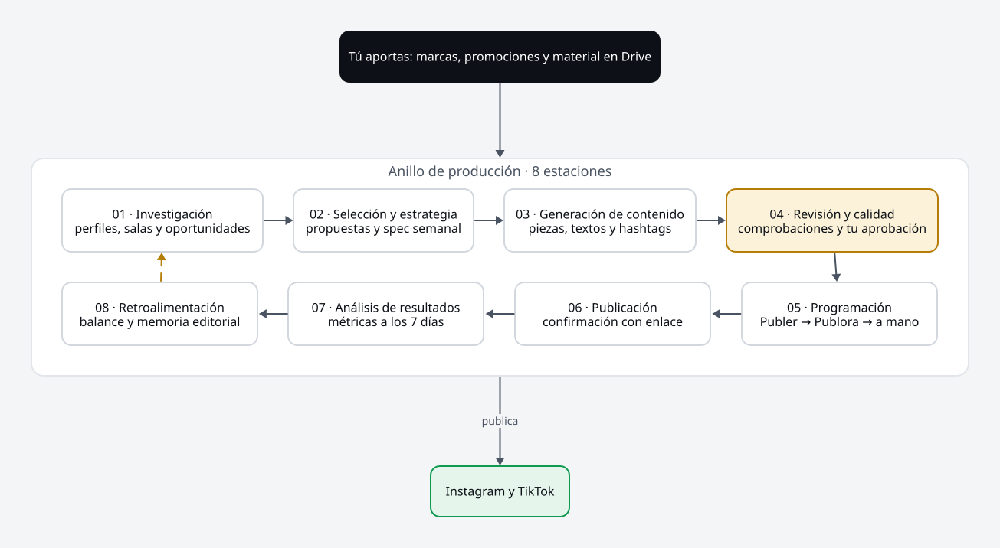

## 3. El mapa de la fábrica

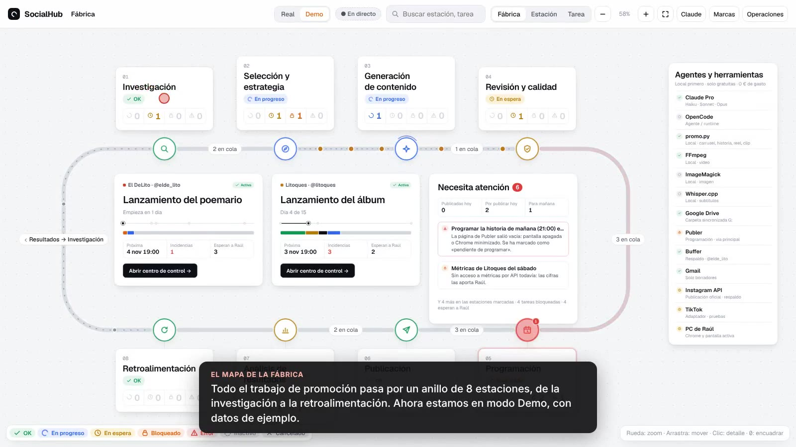

La pantalla principal es el **anillo de 8 estaciones**:

| # | Estación | Qué hace |
|---|---|---|
| 01 | Investigación | Perfiles, contactos y oportunidades |
| 02 | Selección y estrategia | Propuestas de la semana y el plan de piezas |
| 03 | Generación de contenido | Imágenes, vídeos, textos y hashtags; primero herramientas locales |
| 04 | Revisión y calidad | Comprobaciones automáticas, revisión de Claude y tu aprobación |
| 05 | Programación | Publer, Publora o, si no da tiempo, a mano con un LEEME |
| 06 | Publicación | Confirma lo publicado con su enlace |
| 07 | Análisis de resultados | Métricas a los 7 días, sin inventar cifras |
| 08 | Retroalimentación | Balances y propuestas que vuelven a la investigación |

Cada estación muestra su estado y sus contadores: en curso, en espera, bloqueadas y con error. Los puntos del anillo son tareas que pasan de una estación a la siguiente.

En la barra de arriba están:
- El cambio entre **Real** y **Demo**.
- El buscador de estaciones y tareas.
- El zoom. Con la rueda del ratón te acercas a cualquier zona.
- Los botones **Claude**, **Marcas** y **Operaciones**.

A la derecha, **Agentes y herramientas** lista lo que usa la fábrica (Claude, promo.py, FFmpeg, Drive, Publer…) y si está disponible.

### Necesita atención y resumen de hoy

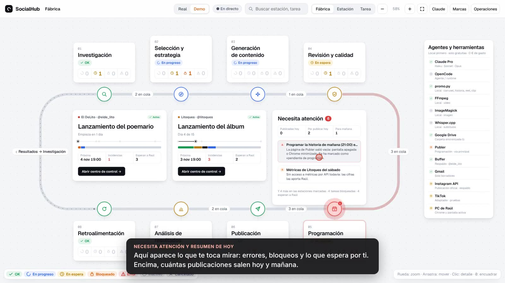

La tarjeta **Necesita atención** reúne lo que te toca mirar: errores, bloqueos, publicaciones para hacer a mano o con un posible duplicado. Al pulsar un aviso vas directo a la tarea, la estación o la publicación.

Encima, el **resumen de hoy** dice cuántas publicaciones han salido hoy, cuántas faltan y cuántas hay programadas para mañana. Solo está en la app: no manda notificaciones.

### Una estación y una tarea

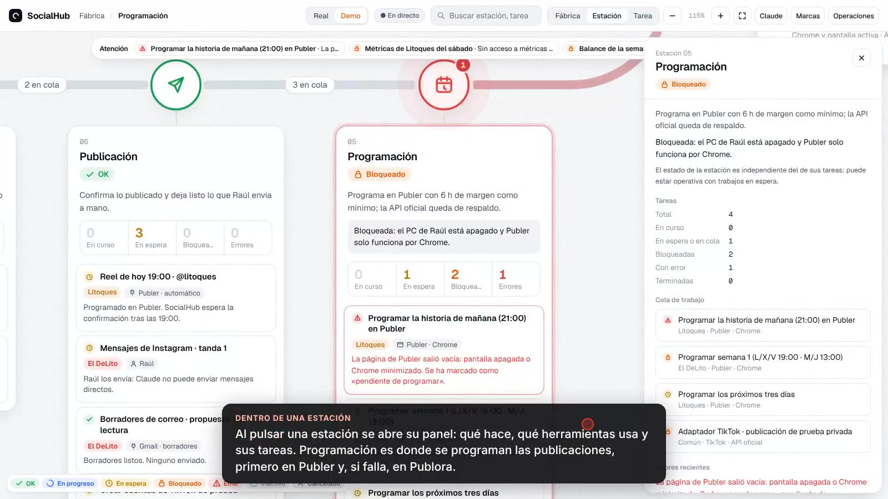

Al pulsar una estación se abre su panel con:
- Qué hace y qué herramientas usa.
- Sus contadores.
- La cola de trabajo y los errores recientes.

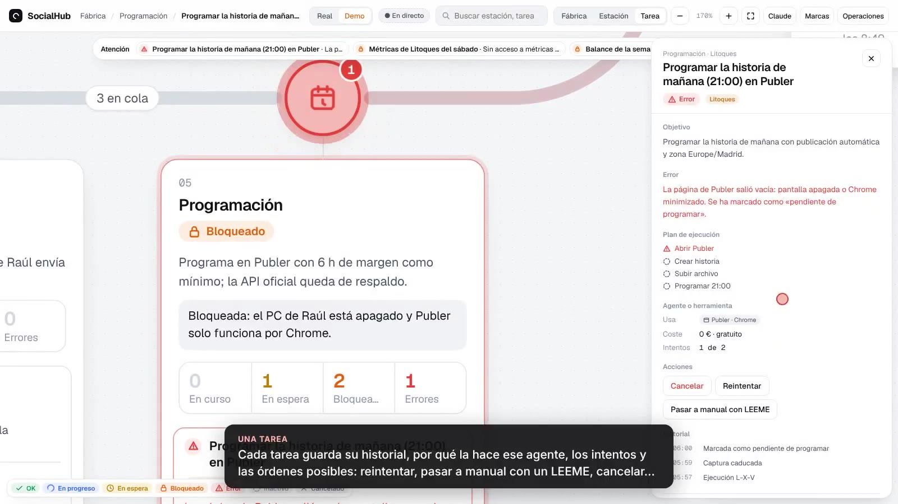

Cada **tarea** tiene:
- Su objetivo y el plan de pasos.
- El agente o la herramienta que la hace, el coste y los intentos.
- Su historial.

Según su estado, las órdenes son: reintentar, pasar a manual con un LEEME, cancelar, aprobar como Raúl, ejecutar ahora…

## 4. Centro de control de una promoción

Cada promoción tiene su centro de control («Abrir centro de control →» en su tarjeta del mapa).

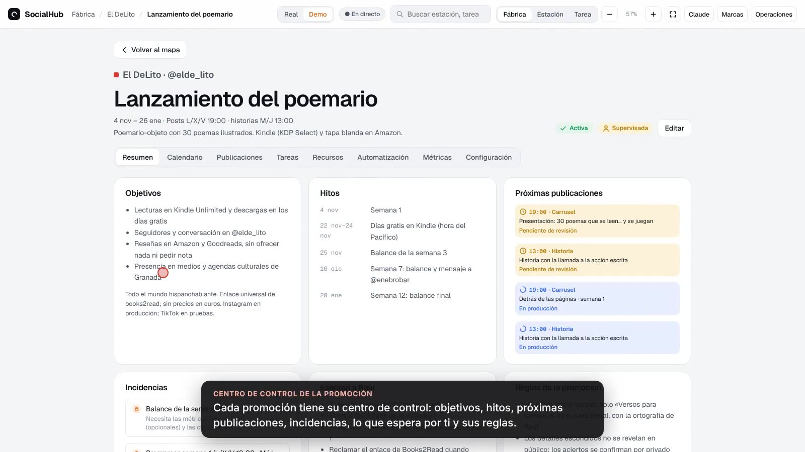

- **Resumen:** objetivos, hitos, próximas publicaciones, incidencias, lo que espera por ti y las reglas de la promoción.
- **Calendario:** la semana día a día.

  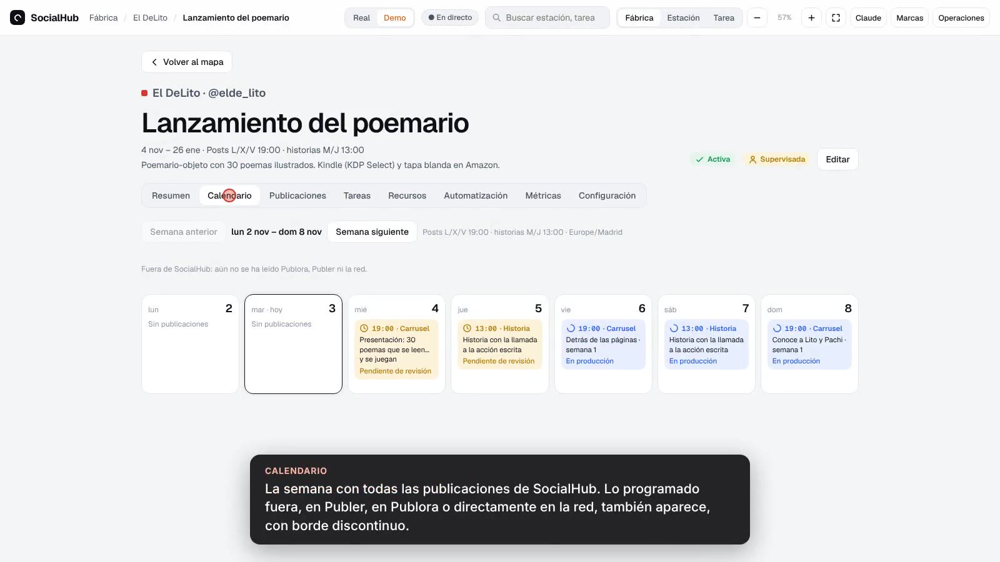

  Además de las publicaciones de SocialHub, aparece **con borde discontinuo** lo programado o publicado fuera:
  - **Publora:** se lee por su API cada hora.
  - **Publer y lo publicado en la red:** los lee Claude con Chrome una vez al día.

  Arriba se indica cuándo se leyó cada fuente y si falló.

- **Publicaciones:** todas, con su estado, y filtros por propuestas, pendientes, en revisión, programadas, publicadas o con incidencia.

  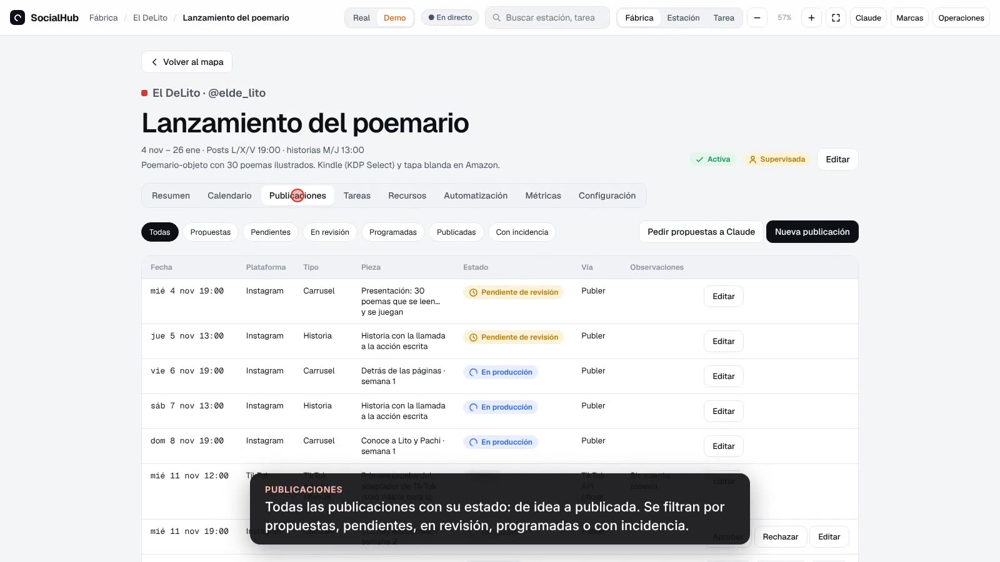

- **Propuestas:** cada lunes desde las 18:00, Claude propone las publicaciones de la semana siguiente.
  - Al aprobar una, pasa a «En producción».
  - Al rechazarla, se pide un motivo, y ese motivo va a la memoria editorial.

  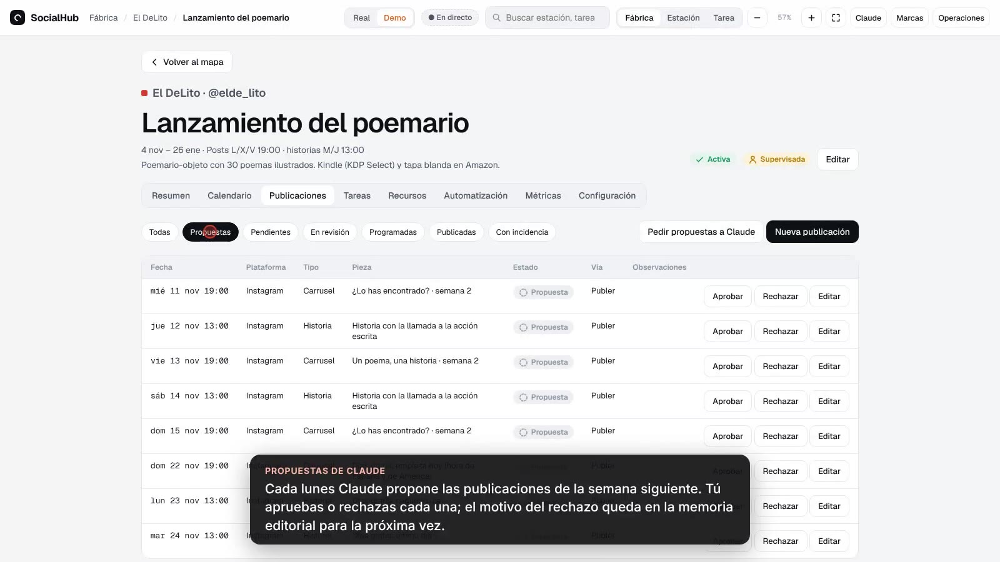

- **Tareas:** las de la fábrica para esta promoción.

  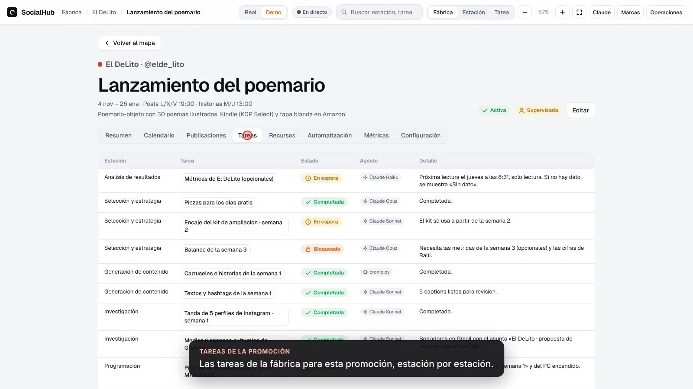

- **Recursos:** las carpetas de Drive de la promoción (las que cambian respecto a la marca) y sus documentos.
- **Automatización:** tareas programadas, vías de publicación y qué modelo de Claude se usa para cada trabajo.

  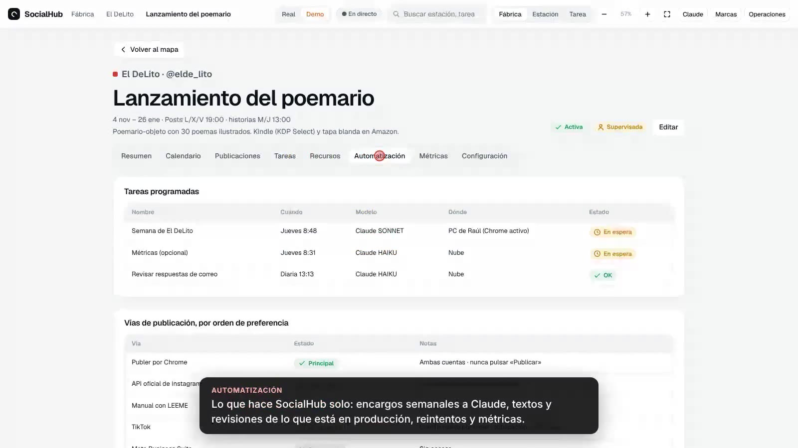

- **Métricas** y **Configuración:** las métricas de la promoción y sus parámetros. Las métricas reales de cada publicación se ven en la propia publicación.

### Editar una publicación

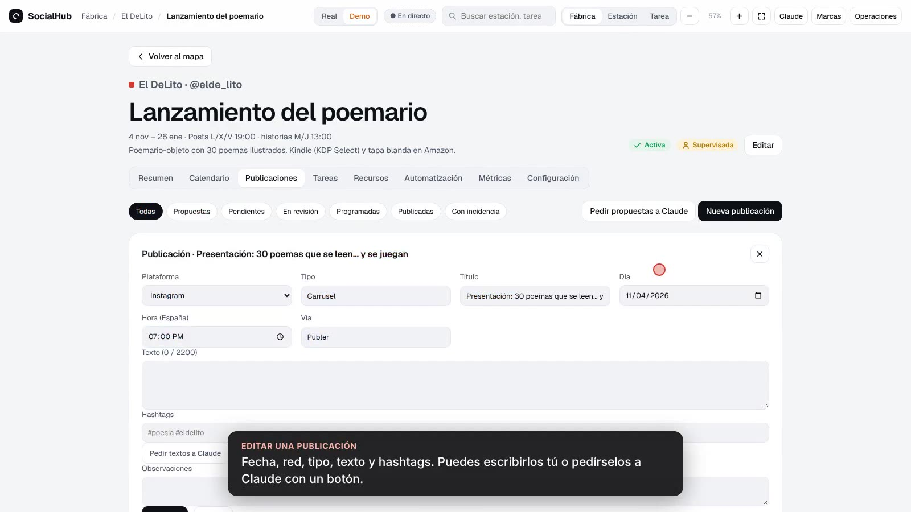

El editor tiene la red, el tipo, el título, la fecha y hora, la vía, el texto, los hashtags y las observaciones.
- **Pedir textos a Claude:** pide a Claude el texto y los hashtags.
- **Descartar texto:** borra el texto de Claude. Pide un motivo, que queda en la memoria editorial.
- Tus correcciones a los textos de Claude también quedan en la memoria, para que Claude imite tu estilo.

**Control de calidad**

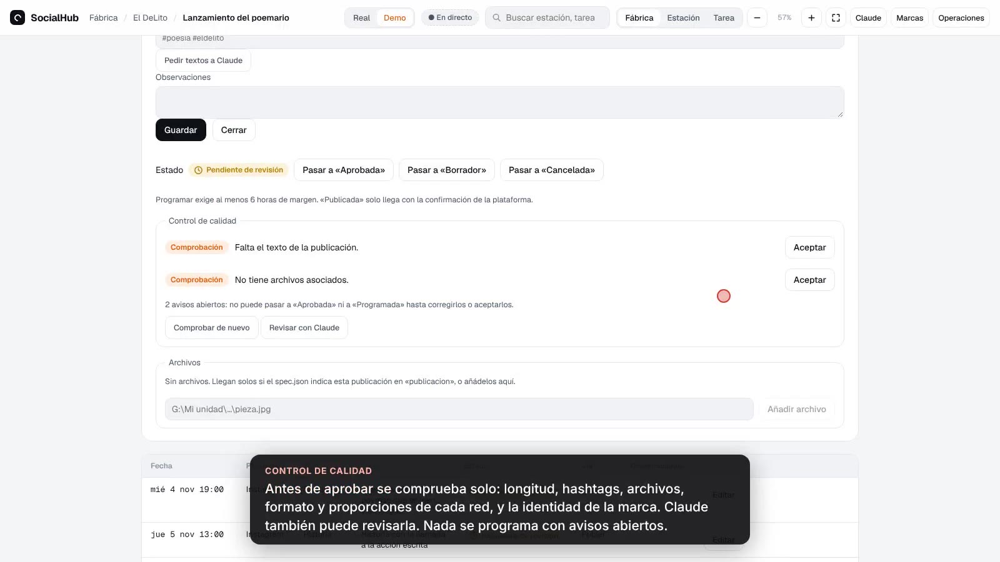

SocialHub comprueba solo:
- Que haya texto y que la longitud y el número de hashtags estén dentro de lo que admite cada red.
- La llamada a la acción y los hashtags fijos de la marca.
- Que no haya expresiones prohibidas ni textos duplicados.
- Que los archivos existan, con el formato, el peso y las proporciones de cada red.

Con **Revisar con Claude**, Claude revisa además el tono, la ortografía y las afirmaciones sin fuente.

Mientras quede un aviso abierto, la publicación **no pasa a «Aprobada» ni a «Programada»**. Cada aviso se corrige o se acepta con un motivo.

**Archivos, publicación y métricas**

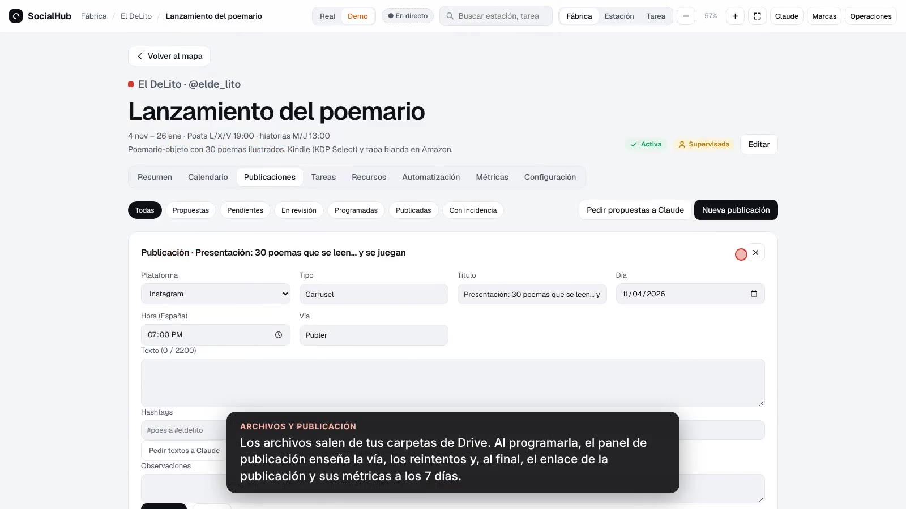

- **Archivos:** salen de las carpetas de Drive de la promoción. Llegan solos con las piezas generadas o se añaden a mano.
- **Panel «Publicación»:** cuando está programada, muestra la vía, la ronda, el próximo intento, el enlace o el LEEME, y el historial.
- **Panel «Métricas»:** cuando está publicada, muestra reproducciones, alcance, me gusta, comentarios, guardados y compartidos, leídos a los 7 días. Lo que no se pudo ver sale como «Sin dato».
- **Incidencias:** si tiene una anotada, se da por resuelta con el botón **Resuelto**.

Una publicación **programada no se edita**: para cambiarla, vuelve a «Aprobada» y prográmala otra vez.

## 5. Ciclo de vida de una publicación

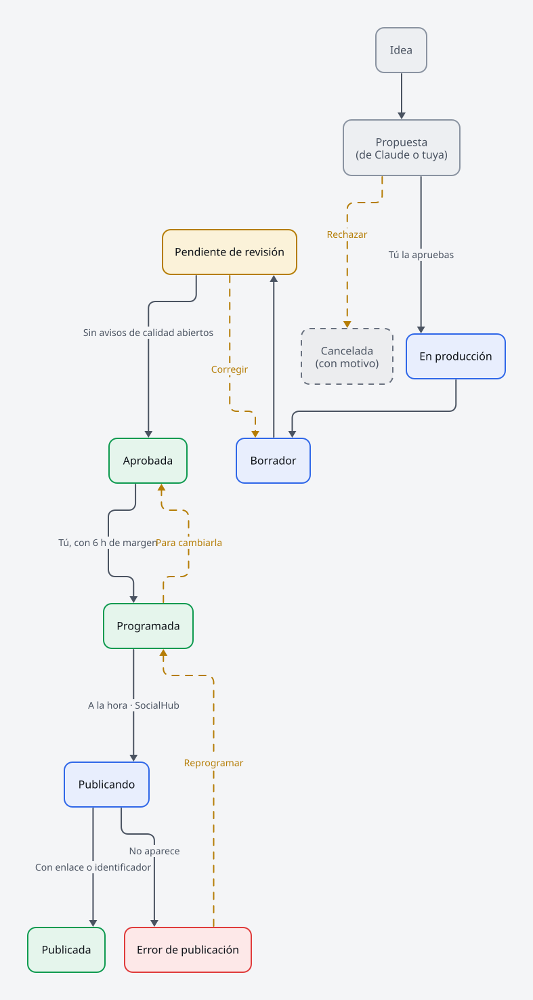

- **Tuyos:** pasar de propuesta a producción, aprobar, programar, cancelar (con motivo) o devolver a un estado anterior.
- **De SocialHub:**
  - «Publicando», «Publicada» y «Error de publicación» solo los pone SocialHub.
  - «Publicada» solo llega con el enlace o el identificador de la red. Nunca se da por publicada sin comprobarlo.

## 6. Cómo se publica

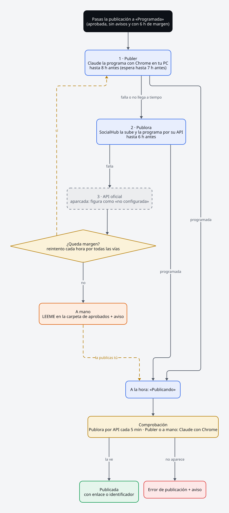

1. **Publer** es la vía principal. Su API es de pago, así que la programa Claude con Chrome en tu PC: la tarea «Publicar con Chrome» pasa cada hora.
   - Tiene que quedar programada **8 h antes**. SocialHub espera su resultado hasta 7 h antes.
   - Si programas algo con menos de 8 h de margen, Publer se salta.
2. **Publora** es la segunda vía, con su API y tu clave (plan gratuito: pocas publicaciones al mes).
   - SocialHub sube los archivos y la programa, hasta 6 h antes.
   - Si la sacas de «Programada», SocialHub la borra él solo en Publora.
3. **API oficial** de Instagram o TikTok: aparcada. Figura como «no configurada».
4. **Si fallan todas**, SocialHub reintenta cada hora mientras quede margen. Si no, deja un **LEEME** en la carpeta de aprobados para que la publiques tú, y te avisa.

**A la hora:**
- La publicación pasa a «Publicando».
- La comprobación empieza 15 minutos después (2 h si la publicas a mano):
  - En Publora, SocialHub la consulta por API cada 5 minutos.
  - Si va por Publer o a mano, la comprueba Claude con Chrome.
- Si no aparece, queda en «Error de publicación» con aviso.

**Posible duplicado:** si Publer la programa tarde, cuando SocialHub ya siguió por otra vía, la publicación queda marcada como «Posible duplicado» y avisa.

## 7. Encargos a Claude y tareas programadas

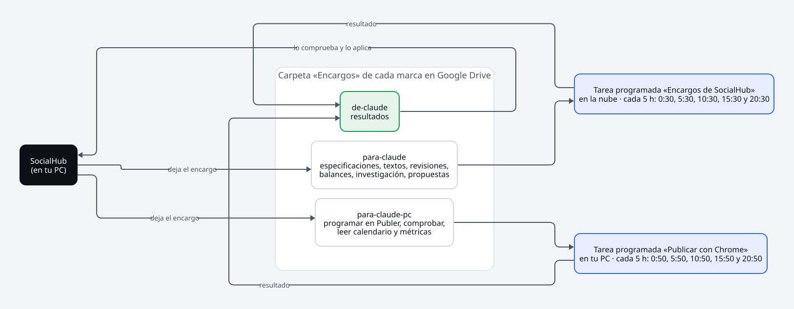

Cada encargo es un archivo en la carpeta **Encargos** de la marca, en Drive.

**Carpeta `para-claude`.** La recoge la tarea programada **«Encargos de SocialHub»**, en la nube, a las 9:40, 14:40 y 20:40. Lleva estos encargos:
- Especificación de piezas de la semana.
- Textos y hashtags.
- Revisión de calidad.
- Balance semanal.
- Investigación.
- Propuestas de la semana.

**Carpeta `para-claude-pc`.** La recoge la tarea **«Publicar con Chrome (SocialHub)»** en tu PC, cada hora de 8:40 a 22:40. Necesita el PC encendido, la app de Claude abierta y Chrome con tu sesión de Publer. Lleva estos encargos:
- Programar en Publer.
- Comprobar la publicación.
- Leer el calendario.
- Leer las métricas.

Los resultados vuelven a la carpeta `de-claude`. SocialHub los comprueba contra el contrato y los aplica; si un resultado no cumple el contrato, la tarea falla con el motivo.

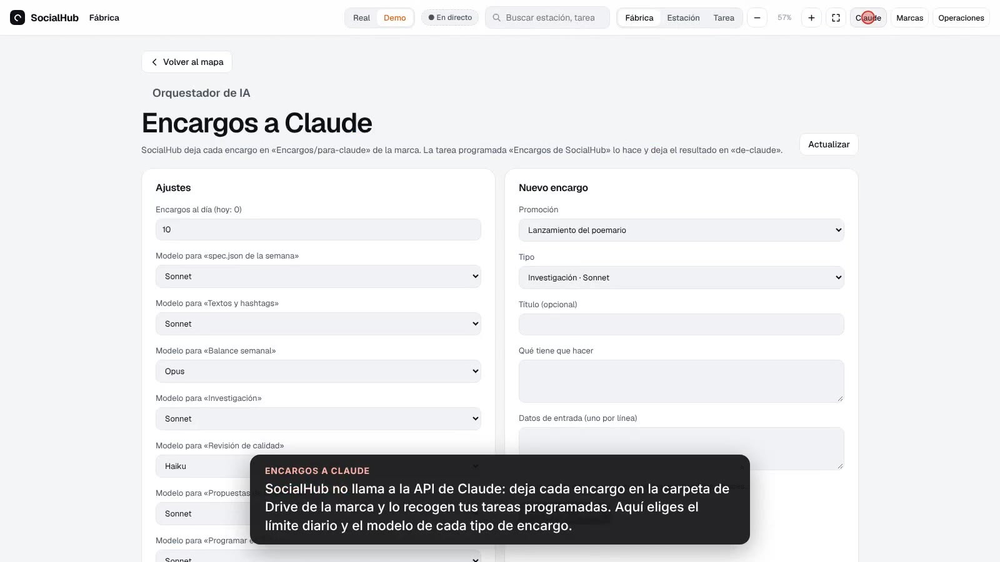

En la pantalla **Claude** se ajusta:
- El **límite diario** de encargos. Los de publicación con Chrome no cuentan: tienen hora fija.
- El **modelo de cada tipo de encargo** (Haiku, Sonnet u Opus).
- Un **encargo a mano** a Claude.

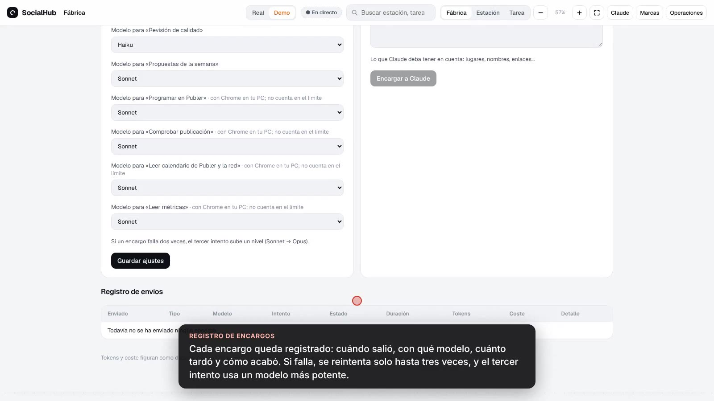

El **registro de envíos** dice cuándo salió cada encargo, con qué modelo, en qué intento, cómo acabó y cuánto tardó.

## 8. Marcas

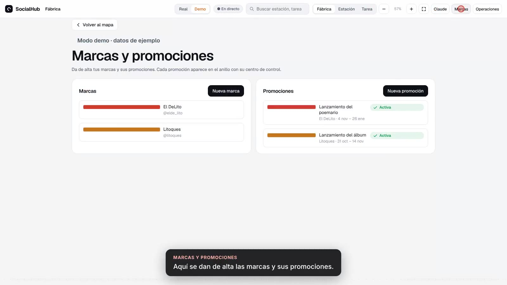

En **Marcas** se dan de alta las marcas y sus promociones. Dentro de cada marca hay cuatro partes.

**Identidad de la marca**

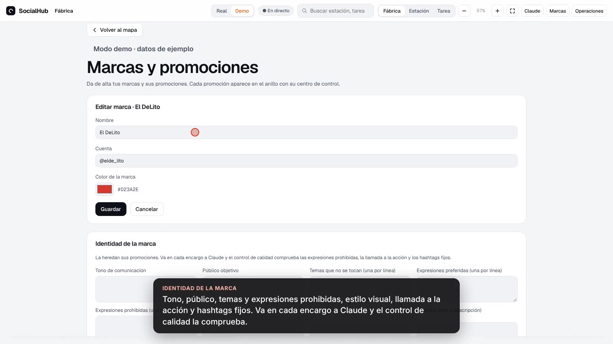

Recoge:
- Tono, público, temas que no se tocan, expresiones preferidas y prohibidas.
- Colores, tipografía, logotipo, estilo visual y fotográfico.
- Llamada a la acción y hashtags fijos.

Va en cada encargo a Claude y la usa el control de calidad.

**Memoria editorial**

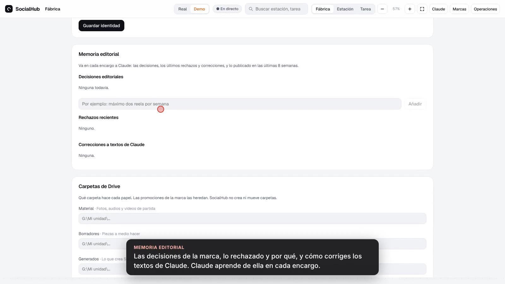

Tiene las decisiones editoriales de la marca, lo rechazado con su motivo y tus correcciones a los textos de Claude. A Claude le llegan las 8 últimas semanas de lo publicado, los 20 últimos rechazos y correcciones, y todas las decisiones.

**Carpetas de Drive y Publora**

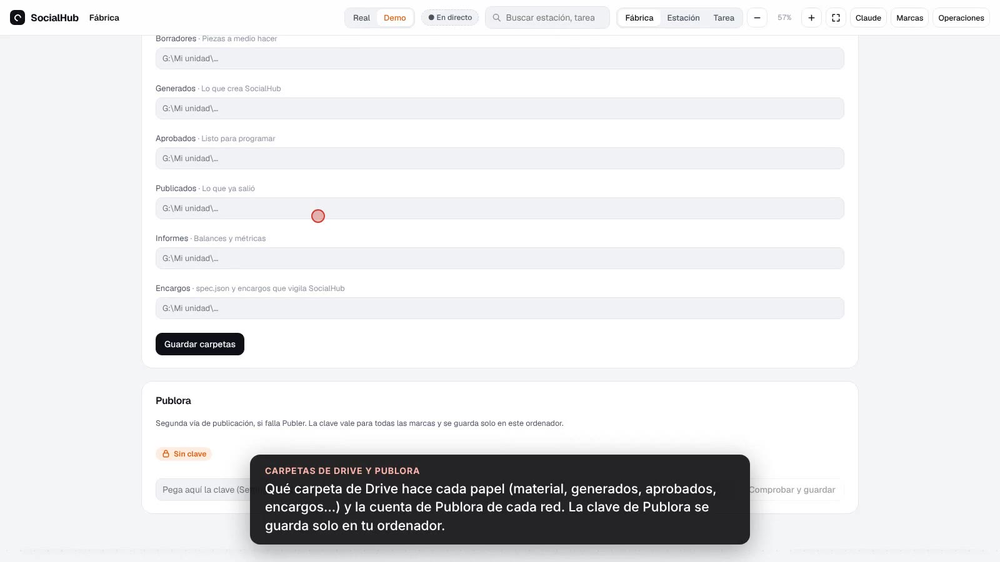

- **Carpetas:** qué carpeta de Drive hace cada papel (material, borradores, generados, aprobados, publicados, informes y encargos). Las promociones las heredan y solo cambian las que necesiten. SocialHub no crea, mueve ni borra carpetas.
- **Publora:** la clave de la API, que vale para todas las marcas, y la cuenta de Publora de la marca en cada red. La clave se comprueba antes de guardarla. Se guarda solo en tu ordenador, legible solo por tu usuario: nunca en la base de datos, en Drive ni en el repositorio.

## 9. Operaciones externas

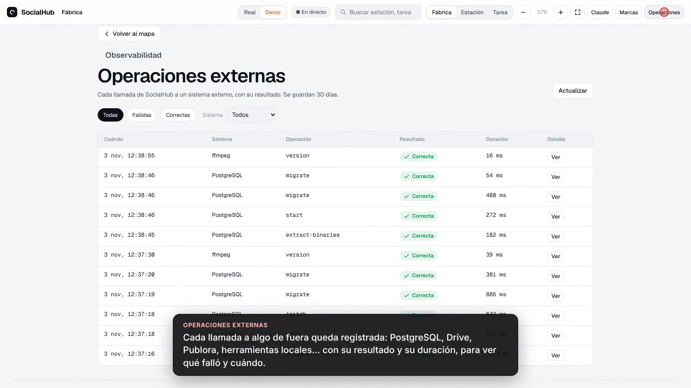

Cada llamada a algo de fuera queda registrada con su resultado y su duración, para saber qué falló y cuándo: PostgreSQL, Drive, Publora, herramientas locales…

## 10. Qué hace SocialHub solo y qué te toca a ti

| SocialHub, solo | Tú |
|---|---|
| Pide cada domingo la especificación de piezas, cada lunes el balance y, el lunes a las 18:00, las propuestas | Apruebas o rechazas las propuestas, con motivo |
| Pide los textos de lo que está en producción sin texto | Corriges los textos si hace falta |
| Pide la revisión de calidad al pasar a «Pendiente de revisión» | Corriges o aceptas cada aviso de calidad |
| Reintenta los encargos fallidos a los 30 minutos, hasta el tercer intento (con un modelo más potente) | Pasas a «Aprobada» y a «Programada» |
| Programa en Publer o Publora, reintenta y, si no da tiempo, prepara el LEEME | Publicas a mano cuando hay LEEME |
| Comprueba lo publicado y lee las métricas a los 7 días | Das por resueltas las incidencias |
| Lee el calendario de fuera (Publora cada hora; Publer y la red una vez al día) | Mantienes abiertos el PC y Chrome para las tareas con Chrome |

## 11. Reglas que siempre se cumplen

- Nada se programa sin tu aprobación, sin pasar el control de calidad y sin **6 h de margen**. Nunca se publica al momento.
- Nunca se simula una publicación: «Publicada» exige el enlace o el identificador.
- Nunca se inventan cifras: lo que no se ve queda «Sin dato».
- Claude no envía correos ni mensajes, no inicia sesión por ti, no crea cuentas y no paga nada.
- Solo herramientas gratuitas. Las claves nunca se suben al repositorio.

## 12. Lo que aún no está

- **Fase 9:**
  - Copias de seguridad diarias en Drive, con restauración desde la app.
  - Instaladores para Windows (`.msi`) y macOS (`.dmg`).

  Está empezada en la rama `fase-9/copias`, donde está su plan (`docs/fase-9.md`).
- **API oficial** de Instagram y TikTok: aparcada ([`docs/fase-7.md`](docs/fase-7.md)).
- **Sin probar con tus cuentas reales:** Publer y Publora, incluidas las historias de imagen en Publora.
