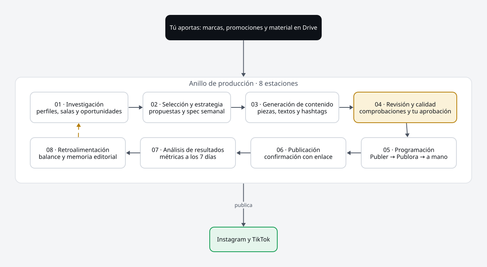
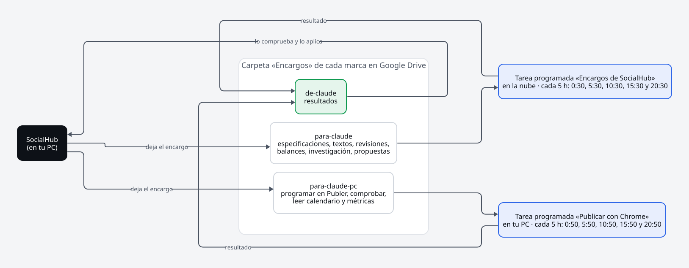

# SocialHub — Content Factory

Fábrica de contenido para redes sociales: investiga, produce, programa, publica y analiza contenido para varias marcas desde una única interfaz visual. Empieza con las promociones de **El DeLito** y **Litoques**.

**→ [Manual funcional](MANUAL.md):** cómo funciona la app hoy, con capturas y diagramas.



## Estado

| Fase | Estado |
|---|---|
| 0 · Análisis y decisiones técnicas | ✅ `docs/fase-0.md` |
| 1 · Prototipo visual | ✅ Propuesta «Moderna» (`docs/prototipos/`) |
| 2 · Backend, persistencia y frontal | ✅ `docs/fase-2.md` |
| 3 · Motor de tareas y herramientas locales | ✅ `docs/fase-3.md` |
| 4 y 5 · Google Drive y encargos a Claude | ✅ `docs/fase-4-5.md` |
| 6 · Producción editorial: identidad, calidad, memoria y propuestas | ✅ `docs/fase-6.md` |
| 7 · Publicación (Publer, Publora y calendario) | ✅ `docs/fase-7.md` (API oficial aparcada) |
| 8 · Métricas y autonomía | ✅ `docs/fase-8.md` |
| 9 · Copias de seguridad e instaladores | Copias e instalador de Windows ✅ · `.dmg` pendiente (`docs/fase-9.md`) |

## Instalar

En GitHub, **Actions › Instaladores › Run workflow** genera `SocialHub-<versión>.msi`. Al lanzarlo puedes elegir publicarlo en una release. Instálalo y ábrelo con el acceso directo: se abre en el navegador, en `http://localhost:8686`. Para cerrarlo, usa el botón **Cerrar** de la barra. Más en el [manual](MANUAL.md#instalar-y-cerrar).

## Cómo trabaja



SocialHub corre en el ordenador de Raúl. No llama a la API de Claude: deja los encargos en Google Drive y los recogen dos tareas programadas de Claude, una en la nube y otra con Chrome en el PC. Más en el [manual](MANUAL.md#7-encargos-a-claude-y-tareas-programadas).

## Documentación

- [`MANUAL.md`](MANUAL.md): manual funcional.
- [`docs/diagramas/`](docs/diagramas/): diagramas en [D2](https://d2lang.com) con los colores de la web. Los SVG se generan con `docs/diagramas/generar.sh`.
  - `anillo`: las 8 estaciones.
  - `ciclo-publicacion`: los estados de una publicación.
  - `vias-publicacion`: Publer → Publora → a mano.
  - `encargos-claude`: encargos y tareas programadas.
- [`scripts/mapa-codigo/`](scripts/mapa-codigo/): mapa 3D del código con zoom semántico. Cada módulo es una isla hexagonal con sus capas (dominio, aplicación, adaptadores de entrada y de salida). Se genera solo en cada PR (comentario con el enlace) o a mano con `npm ci && node generar.mjs` en esa carpeta.
- [`docs/especificacion.md`](docs/especificacion.md): especificación maestra del producto, la fuente de verdad original.
- [`docs/decisiones.md`](docs/decisiones.md): registro de decisiones.
- [`docs/estado.md`](docs/estado.md): estado actual, para retomar el trabajo.
- [`docs/tarea-programada-encargos.md`](docs/tarea-programada-encargos.md): las tareas programadas de Claude.
- [`docs/prototipos/`](docs/prototipos/): prototipos navegables. Se abren directamente en el navegador.
- [`contracts/`](contracts/): API (OpenAPI) y esquemas JSON de intercambio con Claude.

## Estructura

```
backend/     Spring Boot 4 · Java 25 · PostgreSQL incluido · Flyway
frontend/    React · TypeScript · Vite
contracts/   OpenAPI y esquemas JSON versionados
docs/        Especificación, decisiones, fases, diagramas, capturas del manual y prototipos
MANUAL.md    Manual funcional
```

## Reglas del proyecto

- Ante cualquier duda, funcional o técnica, no se hace nada sin preguntar antes a Raúl.
- Solo herramientas gratuitas; nada de pago sin autorización expresa.
- Nunca se envían correos ni mensajes directos en nombre de Raúl, y nunca se publica al instante.
- Los secretos nunca se suben al repositorio.
- El código va en inglés; la documentación y la interfaz, en español.
