# SocialHub · Tutorial para empezar de cero

Para alguien que parte de cero y quiere tener SocialHub funcionando en **Windows** (con una nota para Mac). Todo va paso a paso. Lo que no está confirmado lleva la marca «(pendiente de confirmar)».

**Cómo leerlo.** Cada paso lleva un icono que dice quién lo hace:

- 👤 **Tú:** lo tienes que hacer tú, obligatoriamente (cuentas, contraseñas, claves, permisos, aprobaciones).
- 🤖 **IA:** lo hace Claude (en la nube o con Chrome), o SocialHub solo. Tú no haces nada, solo vigilas.

**Índice**

1. [Qué es SocialHub y qué hace cada pieza](#1-qué-es-socialhub-y-qué-hace-cada-pieza)
2. [Prerrequisitos y cuentas](#2-prerrequisitos-y-cuentas)
3. [Descargar e instalar SocialHub](#3-descargar-e-instalar-socialhub)
4. [Primeros pasos en SocialHub](#4-primeros-pasos-en-socialhub)
5. [Servicios externos](#5-servicios-externos)
6. [Conectar SocialHub con Claude: las dos tareas programadas](#6-conectar-socialhub-con-claude-las-dos-tareas-programadas)
7. [El día a día: qué te toca aprobar](#7-el-día-a-día-qué-te-toca-aprobar)
8. [Prompts útiles para Claude](#8-prompts-útiles-para-claude)
9. [Skills](#9-skills)
10. [Problemas frecuentes](#10-problemas-frecuentes)
11. [Glosario](#11-glosario)

---

## 1. Qué es SocialHub y qué hace cada pieza

SocialHub es una fábrica de contenido para redes sociales. Planifica, produce, revisa, programa y publica en Instagram y TikTok. Más detalle en el [manual](../MANUAL.md).

Son varias piezas que trabajan juntas:

| Pieza | Dónde está | Qué hace |
|---|---|---|
| **SocialHub** | En tu PC (se abre en el navegador) | Planifica, produce las piezas, guarda todo y deja encargos en Drive |
| **Google Drive** | Carpeta sincronizada en tu PC (`G:`) | Es el buzón: SocialHub deja encargos y Claude deja resultados |
| **Claude en la nube** | Servidores de Anthropic | Tarea programada que hace los encargos de pensar: textos, propuestas, revisión, enlaces públicos |
| **Claude con Chrome** | En tu PC | Tarea programada que usa Chrome con tu sesión de Publer para programar y comprobar publicaciones |
| **API oficial de Instagram** | Meta | Vía principal para Instagram: SocialHub publica él mismo a su hora |
| **Publer** | Web de Publer | Vía de respaldo de Instagram y principal de TikTok. Su API es de pago, así que lo maneja Claude con Chrome |
| **Publora** | Web y API de Publora | Siguiente vía de respaldo, con su clave |

SocialHub **no llama a la API de Claude**: solo deja archivos en Drive.

```
   TU PC                                   NUBE
 ┌───────────────┐   encargos    ┌─────────────┐   ┌───────────────────┐
 │  SocialHub    │ ───────────►  │ Google Drive│ ◄─┤ Claude (nube)     │
 │ localhost:8686│ ◄───────────  │  (G:)       │   │ textos, propuestas│
 └──────┬────────┘   resultados  └──────┬──────┘   └───────────────────┘
        │                               │
        │ publica él mismo              ▼
        ▼                        ┌──────────────────┐   programa en
  API oficial Instagram          │ Claude con Chrome│ ─────────────► Publer
  Publora (API)                  │ (en tu PC)       │          (Instagram, TikTok)
                                 └──────────────────┘
```

Orden de vías para publicar: 1) API oficial de Instagram, 2) Publer, 3) Publora, 4) si todas fallan, un archivo LEEME para publicar a mano.

### El flujo completo, de la idea a las métricas

| # | Paso | Quién |
|---|---|---|
| 1 | Crear cuentas, iniciar sesión, aceptar condiciones, generar y pegar claves (sección 2 y 5) | 👤 Tú |
| 2 | Instalar el `.msi` (pide permiso de administrador) | 👤 Tú |
| 3 | Dar de alta marca y promoción, y la identidad de la marca | 👤 Tú |
| 4 | Compartir la carpeta `publico` de Drive («cualquier persona con el enlace») | 👤 Tú |
| 5 | Crear las dos tareas programadas en Claude | 👤 Tú (Claude las crea cuando se lo pides) |
| 6 | Proponer las publicaciones de la semana | 🤖 Claude en la nube |
| 7 | Aprobar o rechazar las propuestas | 👤 Tú |
| 8 | Pedir y generar la especificación de piezas (spec) | 🤖 SocialHub pide; 🤖 Claude en la nube lo hace |
| 9 | Producir las piezas (carruseles, historias, reels) con herramientas locales | 🤖 SocialHub solo |
| 10 | Escribir textos y hashtags | 🤖 Claude en la nube |
| 11 | Revisión de calidad (automática y de Claude) | 🤖 SocialHub solo y 🤖 Claude en la nube |
| 12 | Revisar y aprobar cada publicación (modo supervisado) y dar el OK a lo que se publica | 👤 Tú |
| 13 | Decidir lo que «Qué hacer ahora» te pida | 👤 Tú |
| 14 | Enlaces públicos de las imágenes (para la API de Instagram) | 🤖 Claude en la nube |
| 15 | Programar en Publer (si la vía es Publer) | 🤖 Claude con Chrome |
| 16 | Publicar a la hora por la API oficial de Instagram o Publora | 🤖 SocialHub solo |
| 17 | Comprobar que se publicó | 🤖 SocialHub solo (Publora) o 🤖 Claude con Chrome (Publer o a mano) |
| 18 | Leer calendario y métricas a los 7 días | 🤖 Claude con Chrome |
| 19 | Aprender: rechazos y correcciones vuelven a Claude en cada encargo | 🤖 SocialHub solo |
| 20 | Si algo falla o el PC/Publer pide iniciar sesión: arreglarlo | 👤 Tú |

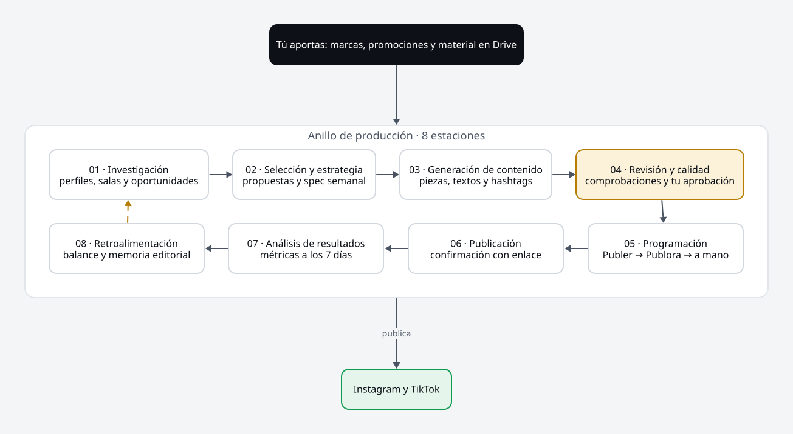

## 2. Prerrequisitos y cuentas

Toda esta sección es 👤 **Tú**: crear cuentas e iniciar sesión no lo puede hacer nadie por ti.

1. 👤 **Google Drive para escritorio.**
   1. Descárgalo en <https://www.google.com/drive/download/> e instálalo.
   2. Inicia sesión con tu cuenta de Google y acepta las condiciones.
   3. Comprueba que en el Explorador de archivos aparece la unidad **G:** con **Mi unidad** sincronizada.
   - Si falla: abre Drive para escritorio desde el menú Inicio y revisa que no esté en pausa.
2. 👤 **Cuenta de Claude de pago** (Pro, Max, Team o Enterprise) y la **app de escritorio**: <https://claude.ai/download>. Inicia sesión en la app.
3. 👤 **Google Chrome y la extensión Claude in Chrome.**
   1. Instala Chrome si no lo tienes.
   2. Añade la extensión: <https://chromewebstore.google.com/detail/claude/fcoeoabgfenejglbffodgkkbkcdhcgfn>.
   3. Sigue la guía: <https://support.claude.com/en/articles/12012173-get-started-with-claude-in-chrome>.
   - **El PC no debe suspenderse.** La tarea de Chrome necesita el PC encendido, la app de Claude abierta y Chrome con tu sesión de Publer. Ajusta la suspensión en Windows (pendiente de confirmar la ruta exacta en tu versión).
4. 👤 **Conectores de Claude** que usan las tareas: **Google Drive** y, si usas Publora, **Publora**. Se activan en los ajustes de Claude (pendiente de confirmar dónde se activan en la app).

## 3. Descargar e instalar SocialHub

1. 👤 Entra en <https://github.com/rvillalba1983/socialhub-content-factory/releases>.
2. 👤 Descarga el archivo `SocialHub-<versión>.msi` de la última versión (**Assets**). En Mac, el `.dmg`.
3. 👤 Ábrelo. Windows avisa con «Windows protegió tu PC» porque el instalador no está firmado:
   1. Pulsa **Más información**.
   2. Pulsa **Ejecutar de todas formas**.
4. 👤 Pide permiso de **administrador**: acéptalo.
5. Al terminar tienes un acceso directo en el escritorio y en el menú Inicio.

**Abrir:** con el acceso directo. Se abre el navegador en `http://localhost:8686`. Si ya estaba abierto, solo se abre el navegador.

**Cerrar:** botón **Cerrar** en la barra de arriba y confirma. Se paran el motor, la base de datos y el servidor. Lo que quedó a medias sigue al volver a abrirlo.

**Actualizar:** instala el `.msi` nuevo encima. Tus datos no se tocan.

**Dónde quedan tus datos y registros:** `%LOCALAPPDATA%\SocialHub` (pega eso en la barra del Explorador). Los registros están en la subcarpeta `logs` (`socialhub.log` y `pg_ctl.log`).

**Copias de seguridad:** botón **Copias** en la barra de arriba.
- Hace una copia al abrir cada día (o a mano con **Hacer copia ahora**).
- Elige como carpeta de copias una carpeta de Drive (G:). Si no, se guardan solo en tu PC y sale un aviso.
- Se guardan las 14 últimas. Restaurar: **Restaurar…** y escribe el nombre de la copia.

**Nota para Mac:** descarga el `.dmg`, y la primera vez ábrelo con clic derecho (no está firmado). Datos y registros en `~/Library/Application Support/SocialHub`. El `.dmg` solo se ha probado en la máquina macOS de GitHub, no en un Mac real. Las rutas tipo `G:\` son de Windows; en Mac la carpeta de Drive es otra (pendiente de confirmar).

## 4. Primeros pasos en SocialHub

Las capturas usan datos ficticios (una marca de ejemplo, «Cafetería Luna») y rutas de prueba en lugar de `G:\...`. En tu PC verás tus datos y tu unidad `G:`.

Al abrir SocialHub ves el **mapa de la fábrica**: las 8 estaciones, lo que está en curso y la lista «Qué hacer ahora».

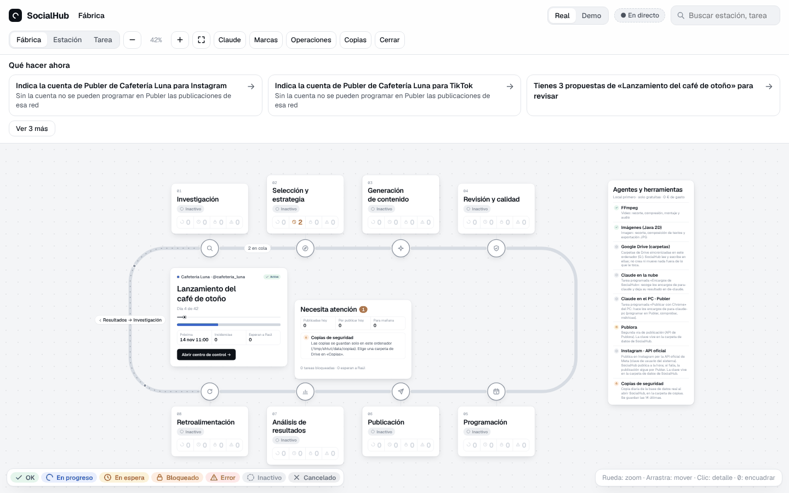

- **Anillo de 8 estaciones:** cada etapa de la fábrica, con sus contadores (en curso, en espera, bloqueadas, con error).
- **Barra de arriba:** navegación, botón **Copias** y botón **Cerrar**.
- **Modo Real / Demo:** dos bases de datos separadas; lo de Demo nunca toca lo real.

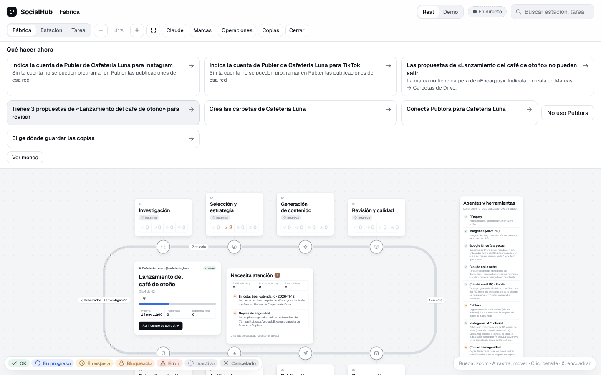

- **Qué hacer ahora:** lo que te toca a ti (👤). Cada fila trae su botón.
- **Necesita atención:** avisos y errores con su motivo.

### 4.1 👤 Alta de marca y carpetas

1. Abre **Marcas**.
2. Da de alta la marca.

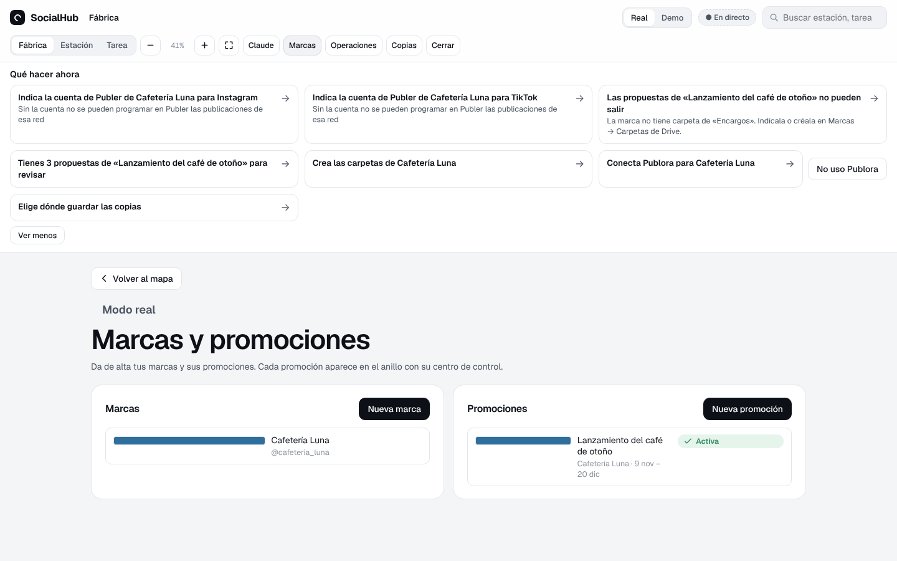

3. Entra en la ficha de la marca. Arriba sale **«Te falta por completar»**:

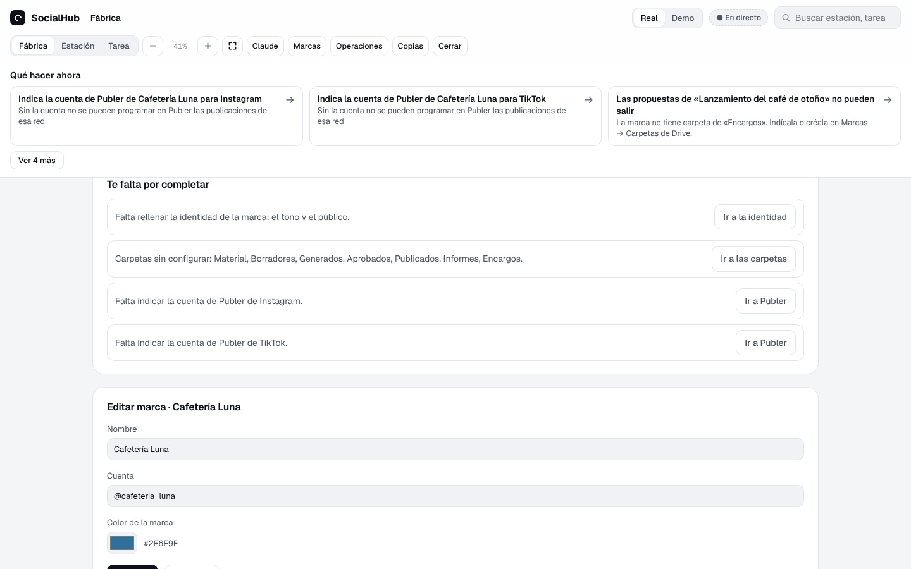

- Cada aviso es una cosa pendiente: identidad (tono y público), carpetas, cuenta de Publer de Instagram y de TikTok, cuenta de Instagram para la API oficial y compartir `publico`.
- Cada aviso tiene un botón que baja a su tarjeta. Si no falta nada, el bloque desaparece.

4. En la tarjeta de **Carpetas**, escribe la **carpeta raíz**, por ejemplo `G:\Mi unidad\socialhub\eldelito`, y pulsa **Crear carpetas**.

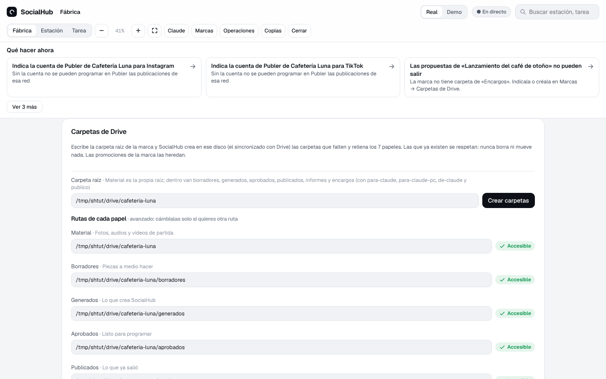

- SocialHub crea `borradores`, `generados`, `aprobados`, `publicados`, `informes` y `encargos` (y dentro de `encargos`: `para-claude`, `para-claude-pc`, `de-claude` y `publico`).
- No borra ni mueve nada que ya exista. Repetir la acción no cambia nada.
- Las rutas de cada papel siguen visibles y editables (avanzado).
- Si sale un error: la unidad `G:` no está disponible o Drive para escritorio no está abierto. Ábrelo y repite.

### 4.2 👤 Identidad de la marca

Es el tono, el público, las expresiones y el estilo. Va en cada encargo a Claude y la usa el control de calidad.

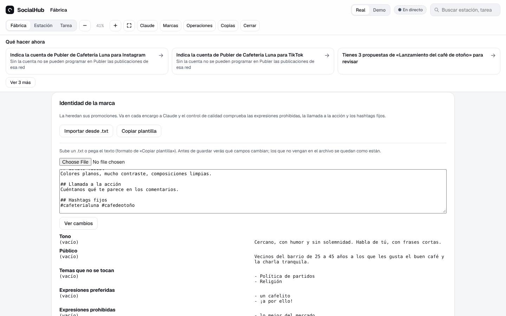

- **Importar desde .txt:** subes un archivo o pegas el texto. Antes de guardar, enseña qué campos cambian (antes y después). Si hay un error, no guarda nada y te dice qué.
- **Copiar plantilla:** copia al portapapeles una instrucción y la plantilla (con tus valores actuales si ya hay identidad), para pegarla en una IA.
- Los campos: tono, público, temas que no se tocan, expresiones preferidas y prohibidas, colores, tipografía, logotipo, estilo visual y fotográfico, llamada a la acción y hashtags fijos.

Pasos:
1. 👤 Pulsa **Copiar plantilla**.
2. 👤 Pégala en una IA (por ejemplo Claude) con lo que sepas de tu marca.
3. 👤 Guarda lo que te devuelva como `.txt`.
4. 👤 Pulsa **Importar desde .txt**, mira los cambios y confirma.

Plantilla (`docs/ejemplos/identidad-marca.txt`):

```
### Identidad de la marca · formato versión 1
### Cada campo empieza con «## Nombre». Las líneas que empiezan por «###» son comentarios y se ignoran.
### Campos de texto: el texto que siga hasta el siguiente «##».
### Campos de lista (Temas que no se tocan, Expresiones preferidas, Expresiones prohibidas, Colores):
### un elemento por línea, empezando por «- ».
### Un campo con «##» pero vacío se queda vacío. Un campo que no aparece no se toca.
### Nombres válidos (sin distinguir mayúsculas ni tildes): Tono, Público, Temas que no se tocan,
### Expresiones preferidas, Expresiones prohibidas, Colores, Tipografía, Logotipo, Estilo visual,
### Estilo fotográfico, Llamada a la acción, Hashtags fijos.

## Tono
### Texto. Máximo 2000 caracteres.
Cercano, con humor y sin solemnidad. Habla de tú, con frases cortas.

## Público
### Texto. Máximo 2000 caracteres.
Lectores de 25 a 45 años a los que les gusta la ironía y las historias de barrio.

## Temas que no se tocan
### Lista. Máximo 50 elementos de 200 caracteres.
- Política de partidos
- Religión

## Expresiones preferidas
### Lista. Máximo 100 elementos de 200 caracteres.
- de aquí a la luna
- ¡a por ello!

## Expresiones prohibidas
### Lista. Máximo 100 elementos de 200 caracteres.
- lo mejor del mercado
- compra ya

## Colores
### Lista. Máximo 20 elementos de 40 caracteres.
- #D23A2E
- #1B1B1B

## Tipografía
### Texto. Máximo 200 caracteres.
Fraunces para títulos, Inter para el texto.

## Logotipo
### Texto. Máximo 500 caracteres.
G:\Mi unidad\socialhub\eldelito\material\logo.png

## Estilo visual
### Texto. Máximo 2000 caracteres.
Colores planos, mucho contraste, composiciones limpias.

## Estilo fotográfico
### Texto. Máximo 2000 caracteres.
Luz natural, planos cercanos, nada de bancos de imágenes.

## Llamada a la acción
### Texto. Máximo 500 caracteres.
Cuéntanos qué te parece en los comentarios.

## Hashtags fijos
### Texto. Máximo 1000 caracteres.
#eldelito #litoques
```

Un campo que no aparece no se toca; las líneas con `###` son comentarios.

Prompt para pedírsela a una IA:

```
Quiero la identidad de mi marca «NOMBRE» en el formato de plantilla que te pego abajo.
Rellena todos los campos con lo que te cuento; si algo no te lo he dicho, déjalo vacío (## Campo sin texto)
y no te lo inventes. Respeta los máximos de caracteres. Devuélvelo en un solo bloque de texto, sin explicaciones.

Sobre mi marca: <describe aquí tono, público, qué no se toca, colores, estilo…>

Plantilla:
<pega aquí la plantilla>
```

### 4.3 👤 Alta de promoción

Una promoción es una campaña de la marca con fechas, objetivos, hitos, cadencia y reglas (por ejemplo, «Lanzamiento del poemario»).

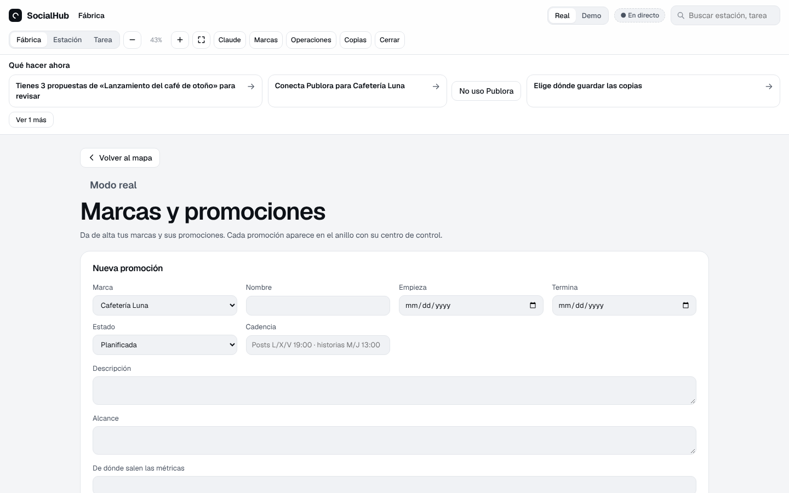

Campos del formulario (los de la captura):
- **Marca:** a qué marca pertenece.
- **Nombre:** cómo la verás en el mapa.
- **Empieza / Termina:** fechas de la campaña.
- **Estado:** Planificada, Activa, Pausada o Terminada. Las planificadas también piden su spec.
- **Cadencia:** cuántas publicaciones y cuándo (ejemplo del formulario: «Posts L/X/V 19:00 · historias M/J 13:00»).
- **Descripción** y **Alcance:** de qué va y en qué redes.
- **De dónde salen las métricas:** de dónde se leen los resultados.
- Más abajo hay objetivos, reglas, hitos, recursos y automatizaciones (pendiente de confirmar el detalle de cada uno).

1. 👤 Pulsa **Nueva promoción** en la pantalla **Marcas**.
2. 👤 Rellena el formulario y guarda.
3. La promoción aparece en el anillo con su botón **Abrir centro de control**.

### 4.4 Centro de control de la promoción

Cuando la promoción existe, su **centro de control** reúne todo en pestañas.

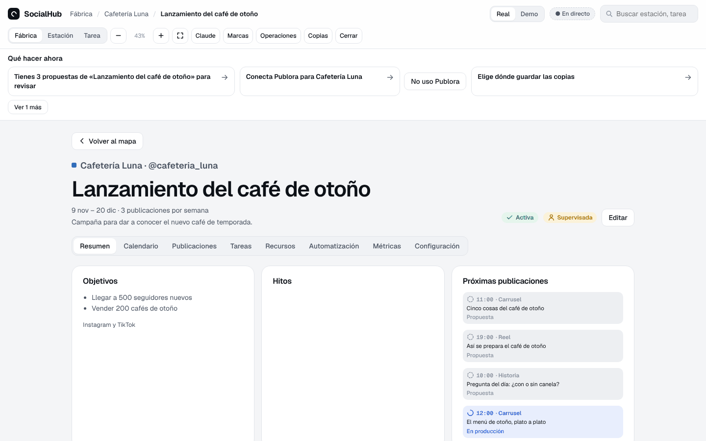

Arriba ves la marca, el nombre, las fechas, la cadencia y dos etiquetas: **Activa** (el estado) y **Supervisada** (tú apruebas cada publicación). Botón **Editar** para cambiar los datos. Las pestañas:

- **Resumen:** objetivos, hitos y próximas publicaciones.
- **Calendario:** las publicaciones por día.
- **Publicaciones:** la lista, con filtros (Todas, Propuestas, Pendientes, En revisión, Programadas, Publicadas, Con incidencia), «Pedir propuestas a Claude» y «Nueva publicación».
- **Tareas:** los trabajos de las estaciones para esta promoción.
- **Recursos:** materiales de la promoción.
- **Automatización:** qué hace solo SocialHub.
- **Métricas:** resultados de lo publicado (sección siguiente).
- **Configuración:** los ajustes de la promoción (pendiente de confirmar el detalle).

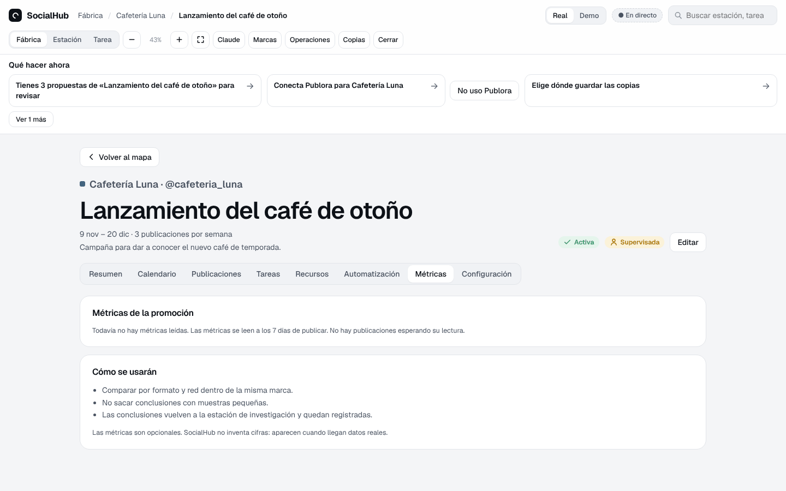

- **Métricas:** lo que se publicó y cómo fue; las lee 🤖 Claude con Chrome a los 7 días.

## 5. Servicios externos

### 5.1 Publer

- **Qué es:** el programador. Vía principal de TikTok y respaldo de Instagram. Lo maneja 🤖 Claude con Chrome, **no hay clave** que pegar.
- **Plan gratuito (Free):** 3 cuentas y 10 publicaciones programadas por cuenta. SocialHub respeta ese tope.
- **Enlace:** <https://publer.com>

Pasos:
1. 👤 Crea tu cuenta en Publer, acepta las condiciones e inicia sesión en Chrome.
2. 👤 Ve a **Cuentas sociales › Conectar** y conecta Instagram (cuenta **profesional**) y TikTok.
3. 👤 En SocialHub, ficha de la marca, tarjeta **Cuenta en Publer**: escribe el nombre de la cuenta **tal como sale en Publer**, para Instagram y para TikTok.

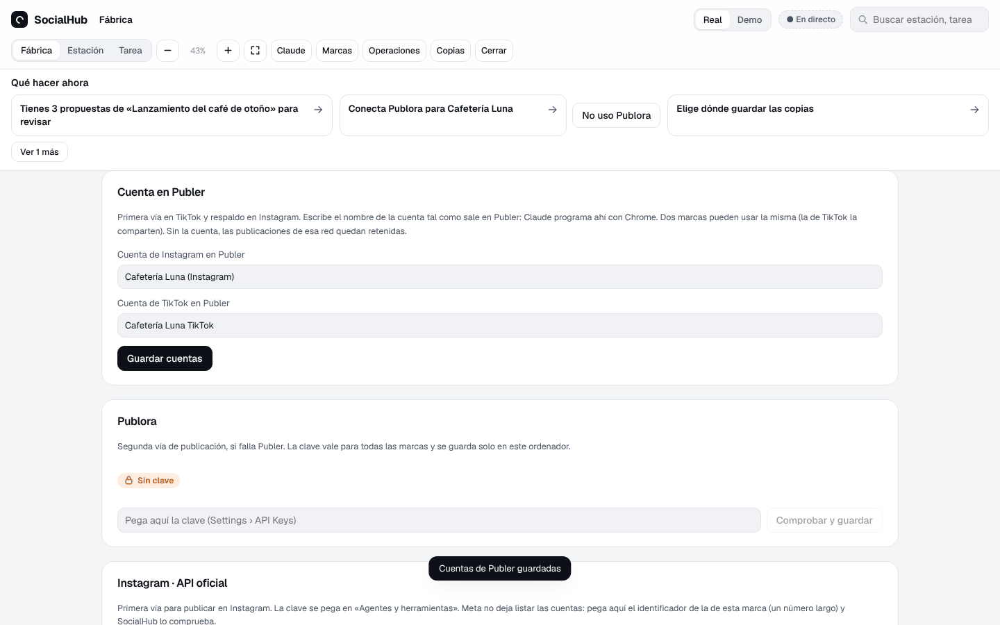

- Sin cuenta no hay encargo: la publicación queda «Retenida» con el aviso «Indica la cuenta de Publer de {marca} para {red}».

### 5.2 Publora

- **Qué es:** vía de respaldo con API.
- **Plan gratuito (Starter):** 15 publicaciones al mes, 3 cuentas.
- **Enlaces:** <https://publora.com> · docs: <https://docs.publora.com/authentication>

Pasos:
1. 👤 Crea tu cuenta en Publora, acepta las condiciones e inicia sesión.
2. 👤 Menú **API › Generate API Key**. La clave **se ve una sola vez**: cópiala.
3. 👤 Conecta tus redes en **Channels › Add Channel**.
4. 👤 En SocialHub, ficha de la marca, tarjeta **Publora**: pega la clave (se comprueba antes de guardarla) y elige la cuenta de Publora de la marca en cada red. La clave vale para todas las marcas y se guarda solo en tu PC.

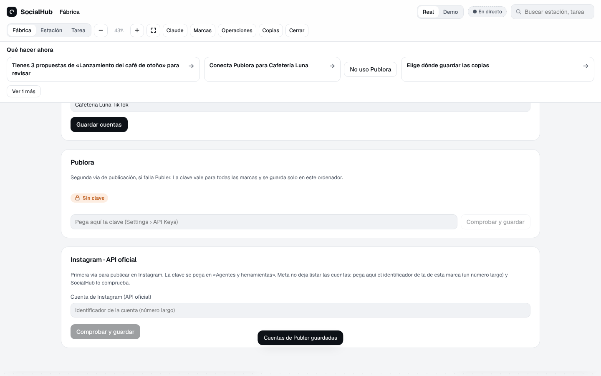

### 5.3 Instagram con la API oficial de Meta

- **Qué es:** vía principal de Instagram. Meta no programa: 🤖 SocialHub publica él mismo a su hora. Límite de 100 publicaciones al día.
- **Necesitas:** una cuenta de Instagram **profesional**.

Pasos (todos 👤 tuyos):
1. **Porfolio empresarial:** entra en <https://business.facebook.com>, **Configuración › Cuentas › Perfiles de Instagram › Añadir**.
2. **App:** en <https://developers.facebook.com/apps> crea una app con el caso de uso **API de Instagram** (con inicio de sesión unificado) y vincúlala al porfolio.
3. **Usuario del sistema:** en el porfolio, **Configuración › Usuarios › Usuarios del sistema › Añadir**, con rol **Administrador**.
4. **Asignar activos:** la app con control total y las cuentas de Instagram.
5. **Generar identificador** (la clave): elige la app, caducidad **Nunca** y los permisos `instagram_basic` e `instagram_content_publish`.
6. En SocialHub, **Agentes y herramientas › Instagram · API oficial**: pega la clave y pulsa el botón de comprobar. Vale para las dos marcas.

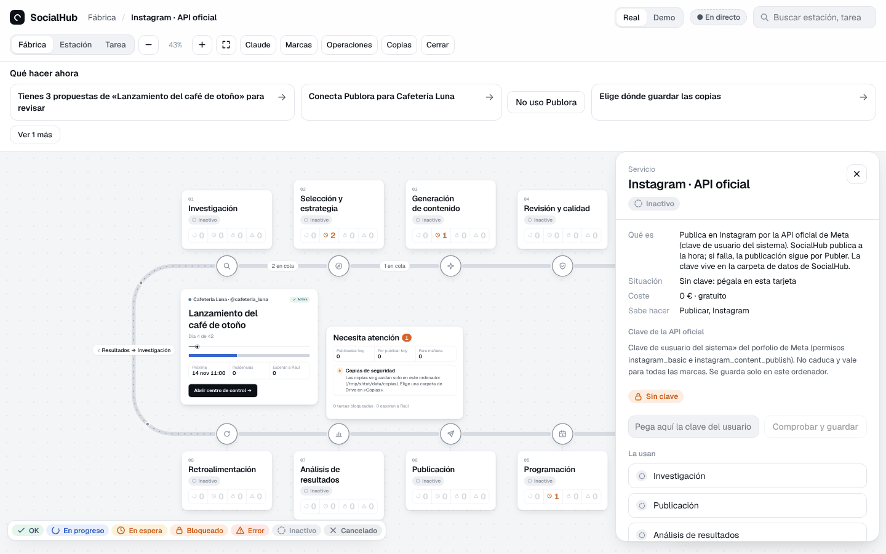

7. En la ficha de cada marca, **Cuenta de Instagram (API oficial)**: pega el ID de su cuenta. SocialHub lo comprueba y enseña el @usuario.
8. **Carpeta `publico`:** en Drive, comparte `publico` (dentro de `encargos` de la marca) con **«cualquier persona con el enlace»** (si no lo hace Claude por ti). Después, en SocialHub, pulsa **Ya está compartida** (no puede comprobarlo él). Meta descarga las imágenes de ahí; SocialHub borra la copia al terminar.

**Advertencia:** la clave es un secreto. **No la pegues en chats.** Si pasó por un chat, regenérala. Nunca va a Drive ni al repositorio.

### 5.4 TikTok

- 👤 Usa una **cuenta personal pública**: la de empresa exige demostrar que eres una empresa real.
- 👤 Se conecta en **Publer** (5.1). SocialHub no la usa por API.
- Una misma cuenta puede servir a varias marcas. Pon su nombre en «Cuenta en Publer» de cada marca. Las marcas que la compartan comparten también el tope de 10 programadas.
- Las publicaciones salen públicas («Todo el mundo»), con Comentarios, Dúo y Stitch activados y sin música añadida.

## 6. Conectar SocialHub con Claude: las dos tareas programadas

Son dos tareas, y hacen falta las dos. 👤 Tú se las pides a Claude; 🤖 después corren solas.

| Tarea | Dónde corre | Qué hace | Horario (`Europe/Madrid`) |
|---|---|---|---|
| **Encargos de SocialHub** | Nube (conector de Drive). No usa tu PC | Recoge `para-claude`: spec de piezas, textos, revisión, balance, investigación, propuestas y enlaces públicos | 00:30, 05:30, 10:30, 15:30 y 20:30 |
| **Publicar con Chrome (SocialHub)** | Tu PC, con Claude in Chrome | Recoge `para-claude-pc`: programar en Publer, comprobar publicación, leer calendario y métricas | 20 min después: 00:50, 05:50, 10:50, 15:50 y 20:50 |

**Regla de urgentes:** las pasadas que caen entre las 08:00 y las 18:00 (10:30/15:30 y 10:50/15:50) solo hacen encargos **urgentes**; las de 20:30, 00:30 y 05:30 (y 20:50, 00:50 y 05:50) lo hacen todo. Lo que pides tú a mano es urgente.

**Cómo crearlas:**
1. 👤 Pídeselo a Claude en la app: «Crea una tarea programada llamada … con este horario y este prompt».
2. La de **Chrome** debe crearse desde una conversación **vinculada a tu PC** (requiere el ordenador).
3. Si ya tienes tareas con estos nombres, no las dupliques (pendiente de confirmar cómo se edita una tarea desde la app).

Los horarios con `CRON_TZ=Europe/Madrid` siguen solos el cambio de hora. Aprobaciones: automáticas. Avisos: notificación en el móvil.

La pantalla **Claude** de SocialHub ajusta el límite diario de encargos y el modelo de cada tipo:

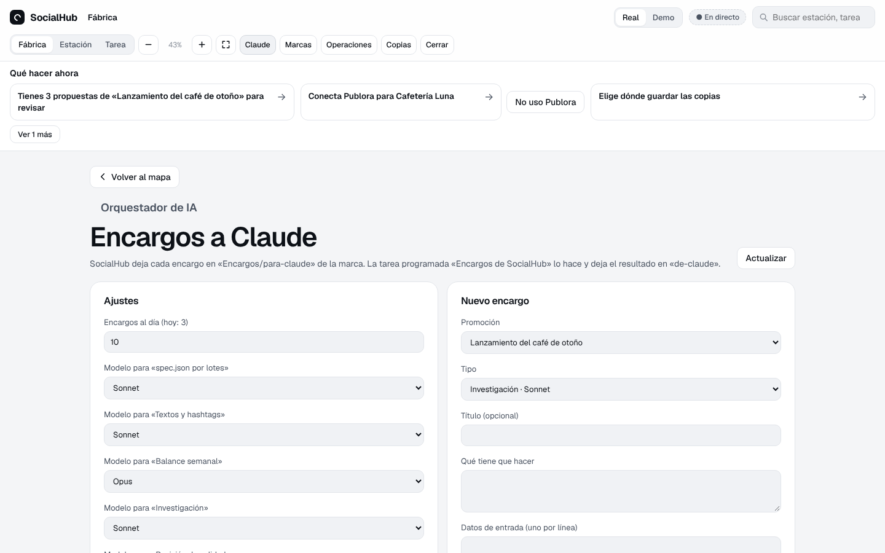

- **Límite diario:** cuántos encargos pide SocialHub al día. Los de publicación con Chrome no cuentan.
- **Modelo por tipo de encargo:** Haiku, Sonnet u Opus.
- **Encargo a mano:** lo pides tú y es urgente.
- **Registro de envíos:** cuándo salió cada encargo, con qué modelo, intento, resultado y duración.

### 6.1 Texto de «Encargos de SocialHub» (nube) · versión 1.1.0

Instrucción tal como está en `docs/tarea-programada-encargos.md`. El propio documento dice que el texto completo vigente está en la tarea; este es el del repositorio.

```
Eres el agente de «Encargos de SocialHub», la app de Raúl Villalba (Lito) para promocionar «El DeLito» y «Litoques».
Háblale de tú y en español. SocialHub te deja encargos en Google Drive y recoge tus resultados del mismo sitio.

NO USES EL ORDENADOR DE RAÚL: nada de herramientas remote-devices, navegador integrado, Claude in Chrome ni computer use.
Todo se hace desde la nube con el conector de Google Drive, WebSearch y WebFetch.

1. Busca en Google Drive las carpetas llamadas «para-claude». Cada una tiene al lado una carpeta «de-claude».
   Ignora las carpetas «para-claude-pc» y sus encargos: esos los hace la tarea del PC con Chrome.
2. En cada «para-claude», cada archivo «<tarea>-<intento>.json» es un encargo (contrato socialhub.task-request v1).
   Está pendiente si en su «de-claude» no hay ningún archivo cuyo nombre empiece por «<tarea>-<intento>».
   Si la hora actual está entre 08:00 y 18:00 en Madrid, haz solo los encargos con urgent=true (campo «urgent» de la
   raíz del encargo; si falta, es false); los demás déjalos pendientes, sin crear resultado ni tocarlos: los hará la
   pasada de la noche. Fuera de ese horario, haz todos.
   Si no hay ninguno que toque hacer, termina con «Sin encargos» sin hacer más llamadas.
3. Por cada encargo pendiente, por orden de nombre, lanza UN subagente con la herramienta Agent
   (subagent_type "general-purpose", model = el campo «model» del encargo, run_in_background false).
   Pásale el texto completo del encargo y las «REGLAS PARA CADA ENCARGO» de abajo.
4. Con lo que devuelva, crea en la «de-claude» de esa marca el archivo «<tarea>-<intento>.json»
   (mimeType application/json) con un resultado que cumpla el contrato socialhub.task-result v1:
   {"contract":"socialhub.task-result","version":1,"taskId":"<taskId del encargo>",
    "status":"completed" | "failed" | "needs_human",
    "outputs":{...según el tipo...}, "sources":[{"title","url"}], "warnings":[...], "error": "..." o null,
    "agent":{"runtime":"tarea programada en la nube","model":"<modelo usado>"},
    "startedAt":"<ISO 8601>","finishedAt":"<ISO 8601>"}
   Nunca modifiques ni borres los encargos ni otros archivos.
5. Termina con un mensaje breve a Raúl (SendUserMessage): qué encargos has hecho y su estado.

REGLAS PARA CADA ENCARGO
- Haz exactamente lo que pide «goal», con «inputs», respetando todas sus «rules» y la identidad de la marca
  (inputs.brand_identity). Si el encargo trae inputs.expected_outputs, síguelo también.
- Usa la memoria editorial (inputs.editorial_memory):
  · cumple las decisiones;
  · no repitas lo publicado en las últimas 8 semanas;
  · no vuelvas a proponer lo rechazado y corrige lo que señala el motivo;
  · imita las correcciones de Raúl.
- Nunca envíes correos ni mensajes, nunca publiques, nunca programes nada y nunca pagues. No inventes datos, cifras,
  enlaces ni usuarios: lo que no puedas comprobar, dilo en «warnings».
- Si necesitas que Raúl decida algo, devuelve status "needs_human" con la pregunta en «error».
- Si no puedes hacerlo, devuelve status "failed" con el motivo en «error».
- Según «type»:
  · socialhub.weekly-spec → outputs.spec: spec de piezas que cumpla contracts/promo-spec.v1 (carrusel, historia,
    reel, clip o comprimir), solo de las publicaciones de inputs.publications (con su scheduled_on y scheduled_time);
    no depende de ninguna semana. Usa rutas completas del ordenador de Raúl dentro de las carpetas de inputs.folders:
    busca los archivos en Drive y une la ruta local de la carpeta con el nombre del archivo. «out» dentro de la
    carpeta GENERATED si existe. Cada pieza que corresponda a una publicación lleva «publicacion» con su id.
    outputs.summary: una línea.
  · socialhub.captions → outputs.publications: [{id, caption (máx. 2200), hashtags (máx. 1000)}] solo para las
    publicaciones de inputs.publications. outputs.summary: una línea.
  · socialhub.weekly-balance → outputs.report (Markdown) y outputs.summary. Solo con datos reales; si faltan métricas,
    dilo.
  · socialhub.research → outputs.report (Markdown, con conclusiones accionables), outputs.summary y «sources».
  · socialhub.quality-review → outputs.issues: [{message}] (lista vacía si está bien) y outputs.summary.
    Revisa coherencia, tono e identidad de la marca, ortografía, afirmaciones sin fuente y restricciones de la marca,
    sin repetir inputs.automatic_checks.
  · socialhub.weekly-proposals → outputs.proposals: [{scheduled_on, scheduled_time, platform, type, title, idea, why}]
    (máximo 21, dentro de inputs.week, siguiendo la cadencia y la memoria editorial, sin repetir
    inputs.already_planned) y outputs.summary.
  · socialhub.public-link → (solo lectura) por cada nombre de inputs.files, busca con el conector de Google Drive el
    archivo con ese nombre exacto dentro de la carpeta «publico» (inputs.folder) y devuelve
    outputs.links: [{file, id}] con el id de Drive (solo el id: SocialHub construye el enlace de descarga).
    Un elemento por archivo; si alguno no aparece, status "failed" diciendo cuál. No muevas, borres, compartas ni
    cambies permisos de nada. outputs.summary: una línea.
```

### 6.2 Texto de «Publicar con Chrome (SocialHub)» (PC) · versión 1.1.0

El repositorio guarda un **resumen**; el completo vigente está en la propia tarea (pendiente de confirmar si coinciden).

```
Eres el agente «Publicar con Chrome» de SocialHub, la app de Raúl Villalba (Lito). Háblale de tú y en español.

1. Busca en Google Drive las carpetas «para-claude-pc». Cada una tiene al lado una carpeta «de-claude».
2. Cada archivo «<tarea>-<intento>.json» es un encargo (contrato socialhub.task-request v1). Está pendiente si en su
   «de-claude» no hay ningún archivo cuyo nombre empiece por «<tarea>-<intento>».
   Si la hora actual está entre 08:00 y 18:00 en Madrid, haz solo los encargos con urgent=true (campo «urgent» de la
   raíz del encargo; si falta, es false); los demás déjalos pendientes, sin crear resultado ni tocarlos: los hará la
   pasada de la noche. Fuera de ese horario, haz todos.
   Si no hay pendientes que toque hacer, termina con «Sin encargos» sin abrir Chrome.
3. Hazlos por orden de nombre, tú mismo, con Claude in Chrome y siguiendo inputs.how:
   · socialhub.publer-schedule → programa en Publer, en la cuenta inputs.publer_account (el nombre de la cuenta tal
     como sale en Publer; no uses otra), la publicación de inputs.publication (texto, hashtags y archivos de «files»,
     en ese orden) para «scheduled_at». Comprueba en el calendario de Publer, en esa cuenta, que aparece una sola vez a
     esa hora. Si inputs.publer_account viene vacío, no programes nada: status "failed". Si la red es TIKTOK, en las
     opciones de publicación de Publer: privacidad «Todo el mundo» (pública desde la primera), Comentarios, Dúo y
     Stitch activados, y no añadas música ni sonidos (los sonidos ya van en el vídeo). outputs: {scheduled: true,
     scheduled_for: "<ISO 8601 con zona>", publer_id (si se ve), url (si la hay), summary}.
   · socialhub.publish-check → mira en Publer (en la cuenta inputs.publer_account) y en el perfil de la red si ya está
     publicada. outputs: {published: true|false, url: "https://…" (si la ves), external_id (si se ve), note, summary}.
   · socialhub.calendar-read → mira lo programado en las cuentas de Publer de inputs.publer_accounts (por red).
4. Con cada resultado, crea en la «de-claude» de esa marca «<tarea>-<intento>.json» (application/json) según el contrato
   socialhub.task-result v1, con agent.runtime "tarea programada en el PC".
5. Termina con un mensaje breve a Raúl: qué has hecho y cómo ha quedado.

REGLAS
- Nunca inicies sesión por Raúl, ni crees cuentas, ni pegues contraseñas. Si Publer pide iniciar sesión, status
  "needs_human" con lo que falta.
- Nunca publiques al momento: solo programa a la hora indicada. Si ya pasó la «deadline» del encargo, no programes
  nada y devuelve status "failed" con el motivo.
- Nunca envíes mensajes ni correos, nunca pagues y nunca borres nada en Publer.
- Antes de programar, mira si ya está programada a esa hora (por un intento anterior): si lo está, no la dupliques y
  devuelve la que hay.
- No supongas nada: «published» solo es true si la ves, con su enlace.
- Si no puedes, status "failed" con el motivo en «error».
```

### 6.3 Prompt listo para pegar

👤 Pégalo en una conversación de la app de Claude vinculada a tu PC. Sustituye `<TEXTO 1>` y `<TEXTO 2>` por los textos de 6.1 y 6.2.

````
Crea estas dos tareas programadas (zona horaria Europe/Madrid, aprobación automática, aviso en el móvil al terminar solo si hubo encargos). No toques ninguna otra tarea que ya tenga. Si ya existe una con el mismo nombre, dime antes de cambiarla.

1. Nombre: «Encargos de SocialHub». Se ejecuta en la nube con el conector de Google Drive.
   Horario: todos los días a las 00:30, 05:30, 10:30, 15:30 y 20:30.
   Prompt: <TEXTO 1>

2. Nombre: «Publicar con Chrome (SocialHub)». Se ejecuta en mi PC con Claude in Chrome (esta conversación está vinculada a mi PC).
   Horario: todos los días a las 00:50, 05:50, 10:50, 15:50 y 20:50.
   Prompt: <TEXTO 2>
````

## 7. El día a día: qué te toca aprobar

1. 🤖 Claude propone las publicaciones de la semana.
2. 👤 **Apruebas o rechazas** las propuestas (con el motivo si rechazas: Claude lo aprende).

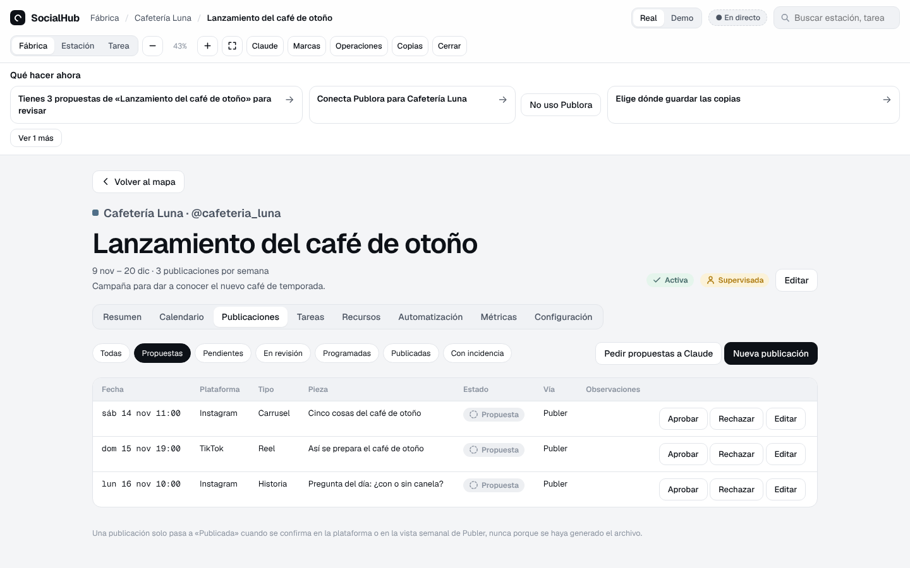

3. 🤖 SocialHub pide el spec, produce las piezas y Claude escribe los textos.
4. 👤 **Revisas y apruebas** cada publicación (modo supervisado) en el editor, y das el OK a lo que se publica.

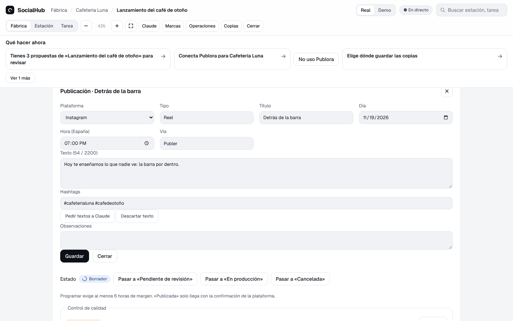

Opciones que ves en el editor:
- **Plataforma, Tipo, Título, Día, Hora (España) y Vía** (Publer por defecto).
- **Texto** (máximo 2200 caracteres) y **hashtags**. **Pedir textos a Claude** lo encarga a 🤖 Claude; **Descartar texto** lo borra.
- **Guardar** guarda los cambios; **Cerrar** cierra el editor.
- **Estado** y botones para cambiarlo: **Pasar a «Pendiente de revisión»**, **Pasar a «En producción»** y **Pasar a «Cancelada»**.
- Programar exige al menos 6 horas de margen. «Publicada» solo llega con la confirmación de la plataforma.

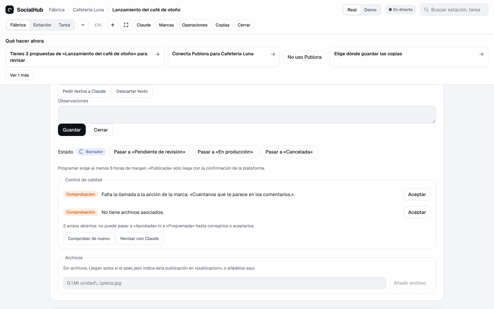

- **Control de calidad:** avisos automáticos (por ejemplo, «Falta la llamada a la acción de la marca» o «No tiene archivos asociados»). Con avisos abiertos no puede pasar a «Aprobada» ni a «Programada» hasta corregirlos o pulsar 👤 **Aceptar** (tú decides que está bien). **Comprobar de nuevo** repite las comprobaciones y **Revisar con Claude** pide la revisión a 🤖 Claude.
- **Archivos:** llegan solos si el spec de Claude indica la publicación, o los añades tú con una ruta y **Añadir archivo**.

5. 👤 Atiendes lo que **«Qué hacer ahora»** te pida (por ejemplo «Pedir contenido ya» si una publicación está a menos de 3 días sin contenido).
6. 🤖 Se programa, se publica, se comprueba y se leen las métricas.
7. 👤 Si algo pasa a «Necesita atención» (publicación retenida, error, hora pasada), decides tú.

Regla: nunca se publica al instante; siempre hay un mínimo de 6 horas de margen.

## 8. Prompts útiles para Claude

**Pedir la identidad de una marca**

```
Ayúdame a definir la identidad de mi marca «NOMBRE» para SocialHub. Hazme las preguntas que necesites, de una en una.
Al final dame el resultado en el formato de la plantilla de identidad (campos «## Nombre»).
```

**Revisar el estado de SocialHub**

```
Revisa el estado de SocialHub: qué falta en «Te falta por completar», qué hay en «Necesita atención» y si las
dos tareas programadas («Encargos de SocialHub» y «Publicar con Chrome») están activas y con los horarios correctos.
No cambies nada: dime qué ves y qué haría falta.
```

**Si algo falla**

```
SocialHub me da este problema: <describe qué ves>. ¿Puedo darte permiso para leer los archivos
logs\socialhub.log y logs\pg_ctl.log de %LOCALAPPDATA%\SocialHub? Si te lo doy, léelos, dime qué falló y qué hago.
No cambies nada sin preguntarme.
```

## 9. Skills

- Existe una skill **«socialhub»**: es de desarrollo del proyecto, para Claude. No necesitas usarla.
- Si quieres, puedes crear una skill **de uso** para preparar la identidad de marca o revisar el estado de SocialHub. Es solo una opción: **no existe todavía**.

## 10. Problemas frecuentes

| Problema | Qué hacer |
|---|---|
| **Drive no sincroniza** | Abre Drive para escritorio y comprueba que la unidad `G:` está disponible. Si no lo está, «Crear carpetas» da error y no crea nada, y no se pueden dejar ni recoger encargos. |
| **Claude no recoge los encargos / límite de uso** | Comprueba que las dos tareas están activas y que no has llegado al límite de uso de tu plan de Claude (pendiente de confirmar cómo verlo). Las pasadas de día solo hacen urgentes: lo no urgente espera a la noche. Lo que pides a mano es urgente. |
| **Publer pide iniciar sesión** | La tarea no inicia sesión por ti: devuelve «necesita una persona». 👤 Abre Chrome, inicia sesión en Publer y deja la sesión abierta. |
| **«Publer lleno»** | El plan Free admite 10 programadas por cuenta. Con la cuenta llena no se crea el encargo y la publicación espera, con el motivo visible, hasta que salga alguna. Las marcas que comparten TikTok comparten el tope. |
| **Meta rechaza la clave** | Genera otra con caducidad «Nunca» y los permisos `instagram_basic` e `instagram_content_publish`, con la app y las cuentas asignadas al usuario del sistema (5.3). Pégala en «Agentes y herramientas» y pulsa comprobar. |
| **Publicación «Retenida»** | Mira el motivo en «Necesita atención». Lo más habitual: falta la cuenta de Publer de la marca en esa red. |
| **No se sabe si Instagram la publicó** | No se reintenta: sale «Error de publicación». Mira en Instagram antes de reintentar. |
| **Falló a la hora de publicar** | La hora ya pasó: publícala tú cuanto antes (hay un LEEME en la carpeta de aprobados) o cámbiale la fecha. |
| **Programada con menos de 8 h (Publer)** | Publer se la salta. Programa con margen. |

## 11. Glosario

- **Marca:** El DeLito o Litoques; con su identidad, carpetas y cuentas.
- **Promoción:** campaña de una marca, con fechas y reglas.
- **Publicación:** una pieza para Instagram o TikTok en un día y hora.
- **Encargo:** tarea para Claude. Va como archivo a Drive y el resultado vuelve por el mismo camino.
- **`para-claude` / `para-claude-pc` / `de-claude`:** carpetas de Drive: encargos para la nube, para el PC, y resultados.
- **`publico`:** carpeta de Drive compartida con «cualquier persona con el enlace»; Meta descarga de ahí las imágenes.
- **Tarea programada:** instrucción que Claude ejecuta sola a ciertas horas.
- **Urgente:** encargo que se hace también en las pasadas de día (08:00-18:00).
- **API:** forma de que un programa hable con otro; aquí, Meta y Publora.
- **Clave (API key / identificador):** contraseña de una API. Es un secreto.
- **Modo Real / Demo:** dos bases de datos separadas; Demo no toca lo real.
- **LEEME:** archivo que SocialHub deja en «aprobados» cuando tienes que publicar tú.
